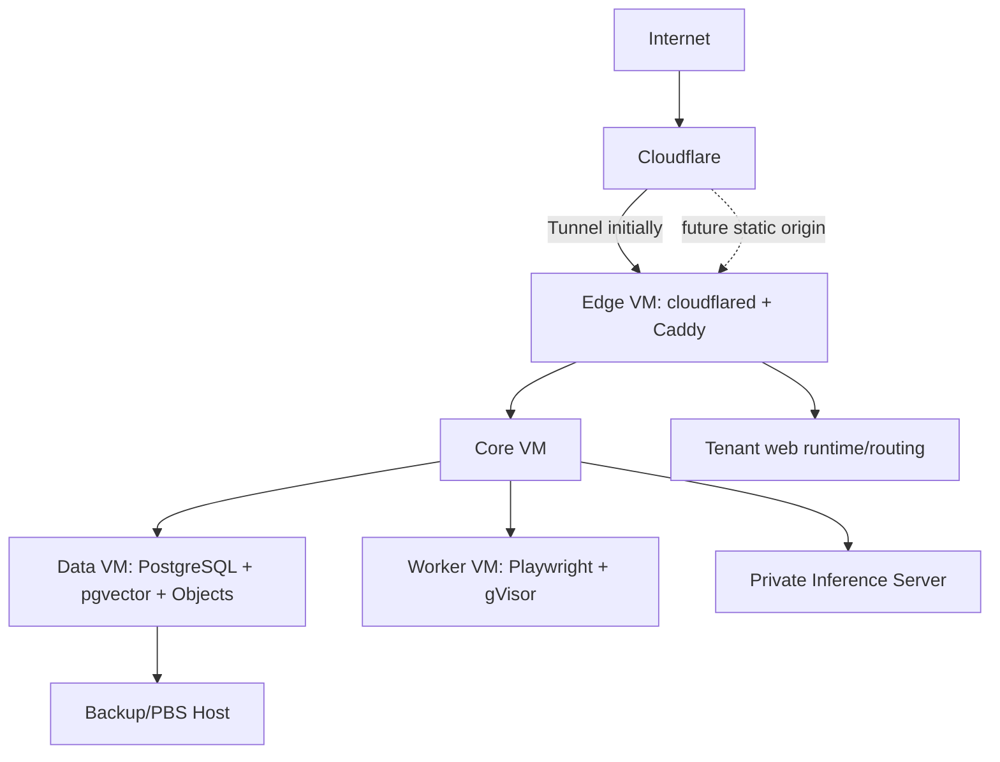
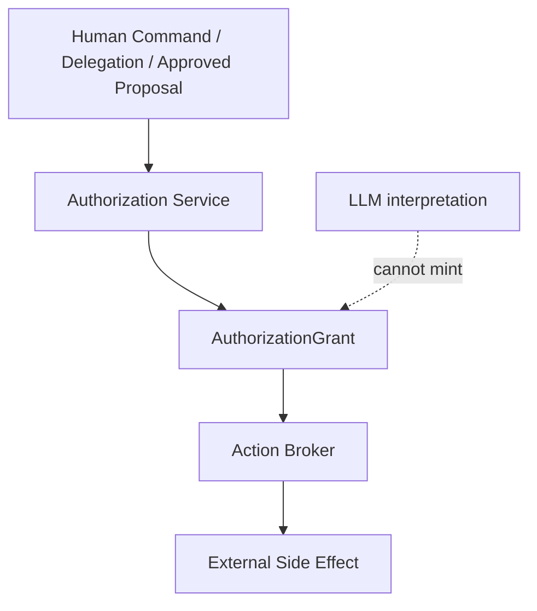

# Presence OS — Master Product & Engineering Specification

> Compiled on 2026-11-25 by `tools/build_docs.py` from the focused documents. Do not edit this file by hand.
> Presence OS is run by one operator for their own companies and managed clients; it is not sold (ADR-0030).
> Accepted ADRs and task contracts in `specs/` control where they differ from this compiled copy.

For implementation, start at `../00_START_HERE.md` and `../specs/R0/README.md`.

---

<!-- Source: docs/CONSTITUTION.md -->

# Presence OS Engineering Constitution

> **Presence OS engineering source of truth**
>
> Baseline date: **2026-08-08** (Asia/Karachi project context).
> Product architecture is intentionally model-, provider-, harness-, and ingress-neutral.
> Vendor capabilities, model names, prices, quotas, laws, and platform policies are time-sensitive reference facts and MUST be revalidated before implementation or purchase.
> When a focused document conflicts with an older discussion, the focused document plus the Decision Register and ADRs control.

These principles are architectural invariants. Changing one requires a deliberate ADR explaining why the new system is safer or materially better.

## 1. Intent over interface

The user should describe outcomes naturally. The system decides which skills, workflows and tools are required.

## 2. Talk first; navigate second

Conversation is the OS shell. Navigation/dashboard is a visual companion, not the primary mental model.

## 3. Human authority

AI can interpret, recommend, plan and execute only within explicit authority. Model inference never creates permission.

## 4. Truth over appearance

Presence OS amplifies evidence-backed truth. It must not fabricate credentials, customers, reviews, experience, awards, outcomes or reputation.

## 5. Tenant sovereignty

The tenant owns its data, assets, domain, knowledge and business decisions. Platform authority and tenant authority are separate.

## 6. Least privilege

Users, agents, skills, connectors, browser identities and services receive the minimum capability required.

## 7. Untrusted content is data

Web pages, emails, social content, files, retrieved documents, MCP/tool output and external observations may contain instructions; those instructions have no authority.

## 8. Evidence before claims

Important facts/claims should carry source/evidence, timestamp, confidence, owner, language and freshness metadata.

## 9. Durable work, not immortal agents

Long waits/retries/schedules live in durable workflows. Agents are invoked for bounded reasoning/work.

## 10. Cache and checkpoint

Stable context should remain stable for provider caching. Expensive research/media/workflow stages should checkpoint and resume.

## 11. Replaceability

Models, providers, harnesses, AI APIs and ingress mode are implementation choices behind stable interfaces.

## 12. Accessible by default

Voice-first does not mean voice-only. Keyboard, screen reader, captions, transcript, contrast, reduced motion, target sizing and clear confirmations are first-class.

## 13. Honest attribution

Separate caused-by from correlated-with. Do not overclaim business impact.

## 14. Ownership and exit

Users can export their Digital Presence Passport, assets and data. Cancellation/offboarding must not become lock-in.

## 15. Build narrow; architect broad

Solve the highest-value work for the operator's companies and clients first while retaining clean extension points for the broader Presence OS vision.

---

<!-- Source: docs/product/vision-and-scope.md -->

# Product Vision and Scope

> **Updated 2026-11-14** for [ADR-0030](../adrs/ADR-0030-operator-run-agency-deployment.md): Presence OS is run by one operator for their own companies and managed clients. It is not sold as a product.

## Mission

Make the operator's own companies and managed clients accurately represented, discoverable, trusted and effective online, with most of the work done by supervised AI.

## What it is

A private, operator-run digital presence system. The operator manages many companies and clients from one place, mainly from a phone: asking for work, scheduling it, approving it and reading reports. Clients may sign in to view, request changes and approve drafts.

## What it is not

- Not a product sold to customers. No signup, plans, billing or reseller mode.
- Not a generic "AI employees" catalog.

## Initial work areas

- competitor and market understanding;
- brand/identity correction;
- website creation or improvement, with hosting;
- SEO/AEO/GEO and AI-search visibility;
- social/local presence, posting through official platform connections;
- content/media;
- review/reputation support;
- conversion improvements;
- later CRM, outreach, support and growth operations.

## Individual / professional
The architecture still supports an individual profile (professional identity, portfolio, LinkedIn presence). It is later work.

## Long-term capability envelope

See the [capability map](capability-map.md). The existence of that envelope does not make all items early requirements.

## Build preference

Product features are written in Presence OS for full control. Other open-source applications are studied for ideas and are not deployed or copied. Proven infrastructure and libraries are used as they are.

---

<!-- Source: docs/product/person-profile-tenant-model.md -->

# Person, Profile and Tenant Model

> **Updated 2026-11-14** for [ADR-0030](../adrs/ADR-0030-operator-run-agency-deployment.md): Presence OS is run by one operator for their own companies and managed clients. It is not sold as a product.

A login belongs to a **Person**. Sign-in is Google sign-in only, by invitation.

## Tenants

A tenant is the isolation and authority boundary for one of the operator's own companies or one managed client. Each tenant isolates:
- limits and budgets;
- connections and secrets;
- knowledge/memory/files;
- browser identities;
- skills and policies;
- usage and workflows;
- audit.

The operator switches between tenants with an explicit context selector, for example:
`Acting as: Company A / Client B / Client C`

## Roles

Platform roles and tenant roles are distinct.

Platform:
- **Operator** (the single owner who runs the deployment).

Tenant:
- Tenant Owner
- Tenant Admin
- Tenant Member
- Client Viewer: read the tenant's properties, content, reports and audit summary;
- Client Requester: Viewer plus submit change requests and connect or disconnect the tenant's external accounts;
- Client Approver: Requester plus approve or reject drafts shown to them;
- Contractor/Delegate.

The operator does not automatically possess tenant business-action authority. For each tenant the operator holds an explicit `TenantAccessGrant` (reason `MANAGED_SERVICE`), created when the tenant is created, and acts in the audited Managed Operator capacity.

No client role can start AI work. A client request creates a queue item for the operator.

## Tenant AI identity
Each tenant owns one stable logical `TenantAIIdentity` / Presence AI. The model behind it is selected by `TenantAIConfiguration` and the platform default; memory, authority and identity do not live in the model instance.

## Digital properties
Each tenant may own multiple `DigitalProperty` records. Property count, runtime and domain limits are per-tenant limits, not identity boundaries.

## Open decision
Whether an operator-owned personal profile is its own tenant or a profile inside a personal tenant (carried from R0-004).

---

<!-- Source: docs/product/conversation-and-home.md -->

# Conversation Shell and Agent Home

> **Presence OS engineering source of truth**
>
> Baseline date: **2026-08-08** (Asia/Karachi project context).
> Product architecture is intentionally model-, provider-, harness-, and ingress-neutral.
> Vendor capabilities, model names, prices, quotas, laws, and platform policies are time-sensitive reference facts and MUST be revalidated before implementation or purchase.
> When a focused document conflicts with an older discussion, the focused document plus the Decision Register and ADRs control.

## Experience goal

Once an authenticated administrator or tenant user enters Presence OS, default landing is the **Agent Home**.

The page should not overwhelm with modules. It should answer:
- What needs attention?
- What improved?
- What opportunities are new?
- What has Presence completed?
- What can I ask/do now?

## Agent Home information model

Primary:
- voice-reactive Presence visualization;
- conversational input/transcript;
- concise synthesis such as “There are two things worth your attention.”

Supporting areas:
- Important / urgent items
- Opportunities
- Recent improvements
- Recent progress
- optional compact health/score indicators

Avoid dashboard-card overload.

## Voice embodiment

The agent does **not need a face**. Preferred direction is an expressive, abstract, voice-reactive kinetic form:
- idle breathing/subtle motion;
- listening contraction/focus;
- speaking deformation/equalizer response;
- thinking/progress state;
- accessible non-motion equivalent.

The form should feel like a crafted instrument/sculptural interface, not a generic glowing AI orb.

## Visual direction — not locked

UI is deliberately editable later. Current constraints:
- avoid stereotypical “AI slop”;
- no default neon blue/purple gradients;
- avoid excessive glow/glassmorphism;
- avoid huge rounded SaaS cards;
- tighter radii, flatter surfaces, strong typography;
- neutral/dark or light themes with a limited accent;
- editorial/asymmetric composition is welcome;
- motion should communicate state, not decorate.

Do not block R0/R1 architecture on final visual design.

## Natural language behavior

Users may speak unfinished thoughts, change direction, use pronouns/references and resume context later.

Conversation state should track:
- active_profile
- active_page
- selected_entity
- last_artifact
- current_preview
- active_task
- recent_references

High-confidence referent: proceed.
Low-confidence referent: ask one short clarification.

## Initiative

Configurable:
- asked-only
- important
- proactive

Communication:
- concise
- balanced
- detailed

Progressive disclosure is default.

---

<!-- Source: docs/product/attention-opportunities-and-scoring.md -->

# Attention, Opportunities, Presence Health and AI Visibility

## Attention model

`AttentionItem.priority`:
- URGENT
- IMPORTANT
- NORMAL
- BACKGROUND

The user can ask “Anything important?” and receive a synthesized answer across modules.

## Opportunity Engine

Central questions:
1. Where is the profile underrepresented, incorrect, stale or invisible?
2. Given current goals and state, what is the highest-value next meaningful action?

Inputs may include:
- analytics;
- CRM/sales;
- search;
- AI search;
- social/local/reviews;
- competitors;
- trends/news/pricing;
- support/calls;
- explicit goals;
- current work.

Initial implementation: rules + scoring + LLM reasoning.

Opportunity fields:
- evidence/source finding;
- impact;
- confidence;
- effort;
- estimated cost;
- expected benefit;
- relevant skills;
- tenant goal;
- freshness;
- status.

## Presence Health

Decompose into explainable components such as:
- identity completeness;
- discoverability;
- trust;
- consistency;
- traditional search;
- AI visibility;
- local/social presence;
- reputation;
- conversion readiness;
- content authority.

Scoring formula must be versioned. Formula changes must not silently imply a customer regressed.

## AI visibility

AI search is stochastic. Do not claim deterministic “rank #3 in ChatGPT.”

Measure:
`Query Set × Location × Language × Provider × Repeated Samples`

Metrics:
- mention rate;
- citation rate;
- visibility share;
- sentiment;
- factual accuracy;
- competitor win rate;
- confidence.

Keep raw sample evidence and methodology.

---

<!-- Source: docs/product/onboarding-and-first-value.md -->

# Client Onboarding and Time-to-Value

> **Updated 2026-11-14** for [ADR-0030](../adrs/ADR-0030-operator-run-agency-deployment.md): Presence OS is run by one operator for their own companies and managed clients. It is not sold as a product.

There is no public signup and no trial. The operator onboards each client.

## Flow

1. The operator creates the tenant and sets its limits, budget and provider policy.
2. Minimal profile input by the operator, text or voice.
3. Presence researches permitted public information.
4. Build the Presence Snapshot.
5. Present what is known, uncertain and missing.
6. The operator invites the client (Google sign-in) with a role: viewer, requester or approver.
7. The client connects their external accounts on each platform's own consent page. Connections are optional and do not block basic value.
8. Produce a prioritized first 30-day plan.
9. Create initial work or a preview where applicable.
10. Show the client what is done, what is proposed and what needs their approval.

Target: the operator sees meaningful work within roughly 10–15 minutes of creating the tenant, without being blocked by DNS or optional integrations.

## Platform-hosted route

Every property gets an immediate random platform hostname. Work can be viewed and shared before a custom domain is connected.

## What the client sees

- before/after;
- evidence-backed work completed;
- drafts waiting for approval;
- their connections, with the ability to disconnect.

---

<!-- Source: docs/product/accessibility-localization.md -->

# Accessibility and Localization

## Accessibility target

WCAG 2.2 AA baseline.

Voice-first must never mean voice-only.

Required:
- keyboard navigation;
- semantic structure;
- screen-reader support;
- captions and streaming transcript;
- clear listening state;
- barge-in/interruption;
- visible confirmations for consequential actions;
- focus visibility;
- target-size requirements;
- reduced motion;
- contrast;
- accessible authentication;
- no drag-only interaction;
- redundant-input avoidance.

Testing must include automated checks plus manual keyboard, NVDA/VoiceOver and RTL testing.

## User preferences

- voice + text
- voice mostly
- text mostly
- text only
- speech speed
- response verbosity
- initiative level
- reduced motion
- simplified mode

## Localization architecture

Separate:
- conversation language;
- content language;
- locale;
- timezone;
- currency.

Use:
- Unicode;
- CLDR;
- BCP 47 language tags.

Support code-switching and transliteration.

Launch priority favors broadly spoken international languages such as English, Spanish, Mandarin Chinese, Hindi, Arabic, French, Portuguese, Japanese and German. Urdu is desirable and architecture-supported but is not a launch blocker.

Preserve original-language evidence. Support RTL structurally from the beginning.

---

<!-- Source: docs/product/trust-and-attribution.md -->

# Trust, Truth and Attribution

Presence OS must be useful without inventing prestige.

Never fabricate:
- customers;
- testimonials;
- reviews;
- awards;
- credentials;
- employment;
- experience;
- results;
- certifications.

Important public claims should be traceable to canonical facts/evidence.

## Impact reporting

Distinguish:
- **CAUSED BY:** supported by credible attribution/experiment/path.
- **CORRELATED WITH:** happened in the same period but causality is not established.
- **OBSERVED:** raw fact without causal interpretation.

The dashboard should prefer honest uncertainty over dramatic numbers.

---

<!-- Source: docs/product/capability-map.md -->

# Long-Term Capability Map

This is the architectural envelope, not MVP scope.

## Research and strategy
- competitor discovery/comparison;
- market, trend and pricing research;
- positioning;
- local/industry research.

## Brand and identity
- brand audit;
- logo/color/typography recommendations;
- canonical identity consistency;
- asset library.

## Web and conversion
- WordPress integration;
- full-stack sites/landing pages/portals/booking systems;
- SEO/AEO/GEO;
- structured data;
- accessibility;
- CRO;
- analytics;
- deployment/rollback.

## Search, AI and local presence
- traditional search;
- AI/answer-engine visibility;
- Google Business Profile/local equivalents;
- directories/listings;
- reviews/reputation;
- consistency scanning.

## Content and media
- text;
- images via local ComfyUI or cloud;
- video on demand;
- audio/voice;
- localization;
- repurposing.

## Social/community
- Facebook;
- Instagram;
- X;
- Reddit/community;
- LinkedIn;
- posting/scheduling;
- comments/engagement;
- connections/networking;
- evidence-based value posts.

## Growth/sales
- lead discovery/enrichment/scoring;
- email;
- SMS;
- WhatsApp/RCS;
- voice;
- social outreach;
- CRM;
- nurture;
- proposals/quotes;
- booking/meetings;
- attribution.

## Customer lifecycle
- support;
- complaints/refunds;
- voice receptionist;
- onboarding/activation/success/retention/upsell/advocacy;
- referral/review/case-study opportunity detection.

## Commerce
- ecommerce;
- feeds;
- marketplaces;
- agentic commerce readiness;
- conversion/product content.

## Paid/earned channels
- ads;
- PR;
- partnerships;
- affiliate/influencer/referral;
- events/webinars;
- YouTube/video;
- ASO.

## Professional/career
- resume;
- portfolio/personal site;
- LinkedIn;
- networking;
- job discovery/application automation with platform/policy/authorization controls.

## Platform/internal
- software development;
- security;
- accessibility;
- localization;
- finance/internal ops;
- Ecosystem Watch;
- Platform Engineer.

Do not build this list as a sidebar or agent catalog.

---

<!-- Source: docs/product/admin-and-managed-service.md -->

# Operator and Managed-Service Experience

> **Updated 2026-11-14** for [ADR-0030](../adrs/ADR-0030-operator-run-agency-deployment.md): Presence OS is run by one operator for their own companies and managed clients. It is not sold as a product.

## Operator console

The console is mobile-first, on its own control-plane hostname, with Google sign-in only. From a phone the operator can:
- ask for a task in plain language;
- schedule recurring tasks;
- read reports;
- approve or reject drafts and actions;
- start or approve runs that use the operator's subscription;
- deploy or modify a property;
- see cost per client.

Agent Home may synthesize:
- tenant incidents;
- reauthentication requirements;
- failing workflows;
- provider/API degradation and subscription rate limits reached;
- cost anomalies and budget thresholds;
- backup/restore health;
- pending releases;
- ecosystem/API changes.

## Acting on a client's tenant

- show "Acting as Managed Operator" clearly;
- show tenant context persistently;
- enforce the TenantAccessGrant;
- audit authority source and reason;
- the client can see the access.

## Client request and approval queue

A client request never runs anything by itself. It lands in the operator's queue. Where a tenant requires it, a draft waits for the Client Approver before it is published. An approval covers only the exact artifact shown.

## Maintenance agent

A future Platform Engineer/Ecosystem Watch may detect external API changes, diagnose adapter breakage, create a tested patch and ask the operator for release approval. It never self-approves production changes.

## AI policy administration
The operator maps task classes to versioned model profiles, sets a per-tenant override and provider policy, inspects the effective resolution, and changes a default with preview and rollback. Tenant overrides are preserved.

The Platform/Admin AI has separate platform configuration and does not become a tenant's Presence AI or inherit tenant business authority.

---

<!-- Source: docs/architecture/system-overview.md -->

# System Architecture Overview

> **Presence OS engineering source of truth**
>
> Baseline date: **2026-08-08** (Asia/Karachi project context).
> Product architecture is intentionally model-, provider-, harness-, and ingress-neutral.
> Vendor capabilities, model names, prices, quotas, laws, and platform policies are time-sensitive reference facts and MUST be revalidated before implementation or purchase.
> When a focused document conflicts with an older discussion, the focused document plus the Decision Register and ADRs control.

## Master abstraction

`GOAL → WORKFLOW → AGENT → SKILL → TOOL → CONNECTOR → PROVIDER`

Runtime flow:

`Human → Voice/Text/UI → Conversation Shell → Intent Resolver → Authority Resolver → Director Agent → Memory/Knowledge/Opportunity → Temporal Workflows → Skill Runtime → Capability Resolver → AI/Tools/Media → Action Broker → Policy/Authorization/Risk/Entitlement → Connector/Provider → External World`

Cross-cutting:
- Tenant Isolation
- Cost Governor
- Resource Governor
- Secrets Broker
- Context Compiler
- Cache
- Audit Ledger
- Observability
- Security Policy
- Evaluation System

## Architectural style

**Modular monolith first** with strongly separated modules and processes where the threat/resource boundary justifies it.

Initial conceptual modules:
- accounts
- tenancy
- profiles
- identity
- authorization
- conversation
- context
- knowledge
- presence
- opportunities
- tasks
- workflows
- approvals
- actions
- skills
- connectors
- providers
- tenant limits
- entitlements
- usage
- limits and budgets
- notifications
- audit
- domains
- deployments
- files
- browser
- inference
- evaluations

Extract services only when scaling, isolation, operational independence or security creates a real need.

## External side-effect boundary

Agents and business modules do not directly publish, send, spend, delete, deploy, change DNS, mutate CRM or perform equivalent external effects. They submit an action through the Action Broker.

## Trust boundary

External web/email/social/file/tool content never receives authority merely because it appears in model context.

## Data boundary

Tenant/profile-scoped records carry tenant_id/profile_id as appropriate, with RLS and application checks.

## Infrastructure boundary

Control plane, tenant-generated sites, untrusted workers and GPU inference are separate zones even if initially deployed on a small number of VMs.

---

<!-- Source: docs/architecture/modular-monolith.md -->

# Modular Monolith Boundaries

## Why

Presence OS has many eventual capabilities, but early microservices would increase development/operations cost, distributed-transaction complexity and autonomous-agent failure modes.

## Rule

Business modules live in one backend deployment where possible, but:
- expose explicit service/application interfaces;
- do not reach into another module's database tables ad hoc;
- publish domain events through an internal outbox where needed;
- keep schemas/migrations owned by modules;
- keep external effects behind Action Broker;
- keep privileged secrets access behind Secrets Broker.

## Processes that may be separate early

Separate processes/VMs are justified for:
- Edge Gateway;
- database/object storage;
- Temporal workers;
- browser/gVisor workers;
- public tenant runtime if needed;
- inference GPU server;
- secrets manager.

This is separation by operational/security boundary, not microservices fashion.

---

<!-- Source: docs/architecture/agent-skill-tool-model.md -->

# Agent, Skill, Tool, Connector and Provider Model

## Avoid one giant agent

The system may implement specialist roles:
- Presence Director
- Research
- Brand
- SEO
- AEO/GEO/AI Presence
- Content
- Web Development
- QA
- Social
- Image/Video
- Community
- Local SEO/GBP
- Analytics/CRO
- Reputation
- Security
- Email/CRM
- Paid Media
- PR
- Ecommerce
- Reporting
- Career/LinkedIn
- Opportunity
- Support
- Voice
- Finance Ops
- Platform Engineer
- Ecosystem Watch

Customers should not be forced to understand this catalog.

## Skill levels

1. Tool skills — small provider/tool operations.
2. Domain skills — coherent domain capability.
3. Composite business skills — multi-step outcome-oriented behavior.

## Skill manifest

Each skill is versioned and declares:
- input/output schemas;
- required capabilities/providers;
- permissions;
- risk class;
- expected/max cost;
- token/tool/time limits;
- retry/checkpoint/cache policy;
- evaluation suite;
- metrics;
- global/tenant/platform scope;
- commercial licensing if relevant.

Skills are independently testable/releasable.

Tenant-created skills may later be promoted globally only through review.

## Capability over model names

Skills ask for capabilities such as:
- high-quality reasoning;
- cheap classification;
- coding;
- vision;
- image generation;
- realtime voice;
rather than hard-coded model IDs.

---

<!-- Source: docs/architecture/workflows-and-temporal.md -->

# Durable Workflows and Temporal

## Principle

Agents do bounded work. Temporal (or the durable workflow layer) owns long waits, retries, schedules and recoverability.

Use workflows for:
- approvals/waits;
- scheduled publication;
- domain verification;
- multi-stage research;
- onboarding;
- campaigns;
- long-running connection repair;
- deployment;
- offboarding;
- human-in-the-loop tasks.

## Workflow design

- Activity/tool calls must be idempotent.
- Checkpoint meaningful expensive stages.
- Retry from the failed stage, not from the beginning.
- Store large model/tool/research/media payloads in object storage/Postgres; workflow history carries artifact references.
- Use deterministic workflow code.
- Give long-lived workflows explicit versioning/upgrade policy.
- Support cancellation/revocation.
- Revalidate authorization and entitlements before delayed side effects.

## Worker upgrades

Use safe versioned deployments and rollback. Temporal Worker Versioning is treated as a capability to exploit, not a reason to deploy Kubernetes early.

## Eventing

Start with transaction outbox + internal event handling where needed. Do not introduce Kafka until event volume/independent consumers justify it.

---

<!-- Source: docs/architecture/context-compiler.md -->

# Context Compiler and Memory Loading

## Goal

Never send the entire historical conversation merely because it exists.

Memory levels:
- L0 recent conversation/task context
- L1 rolling summary
- L2 durable preferences/decisions
- L3 tenant knowledge
- L4 workflow/task state
- L5 immutable/raw archive

Normal model context uses L0 plus relevant L1–L4. L5 is fetched only when needed.

## Prompt order

Keep stable material first:
1. Presence system policy
2. tool/skill contracts
3. authorization
4. tenant-stable context
5. task-stable context
6. retrieval
7. recent messages
8. current request

This improves both relevance and provider prompt caching.

## Cache key inputs

Include where relevant:
- tenant/profile;
- skill version;
- tool version;
- input hash;
- permission context;
- provider/model;
- data/knowledge version.

Invalidate on:
- access revocation;
- permission downgrade;
- tenant deletion;
- knowledge supersession;
- privacy request;
- credential revocation.

Redis is acceleration, not durable truth.

---

<!-- Source: docs/architecture/cost-resource-governance.md -->

# Cost and Resource Governance

## Cost Governor

Controls:
- model tier/reasoning;
- tokens;
- tool calls;
- media operations;
- provider selection;
- retries;
- workflow max cost;
- tenant/service-wallet limits.

Every operation must be attributable by:
- tenant/profile;
- task/workflow/action;
- provider/model;
- tokens including cached tokens;
- tool/media/external cost.

### Reserve then settle

For concurrent expensive actions:
1. reserve budget;
2. execute;
3. settle actual cost;
4. refund unused reservation.

This prevents race conditions where several workers all pass a pre-check.

### Circuit breakers

Stop loops by thresholds on:
- steps;
- turns;
- retries;
- time;
- cost;
- repeated identical failures.

## Resource Governor

Separate from money.

Controls:
- tenant concurrency;
- LLM concurrency;
- GPU queue;
- browser concurrency;
- crawl concurrency;
- media queue;
- background priority;
- provider rate limits.

Weighted fair scheduling prevents noisy neighbors.

Suggested priority:
1. realtime voice
2. interactive user request
3. tenant foreground
4. normal scheduled work
5. internal scans
6. video/background

---

<!-- Source: docs/architecture/concurrency-idempotency.md -->

# Concurrency, Idempotency and Consistency

## Optimistic concurrency

Mutable business resources should expose `version` / `base_version`.

A stale agent edit must return a conflict rather than overwrite another human/agent change.

## Idempotency

Every external side-effect request must carry an idempotency key derived from the action identity/attempt policy.

Retries must not duplicate:
- posts;
- emails/messages;
- payments/spend;
- CRM records;
- DNS changes;
- deployments;
- destructive operations.

## Artifact integrity

Artifact-bound approvals store a hash. Material edits invalidate the approval.

## Outbox

When a database change must reliably trigger async work:
- commit state + outbox event atomically;
- workers consume with idempotency;
- mark delivery separately.

Avoid distributed transactions.

---

<!-- Source: docs/architecture/relationship-and-conversation-graph.md -->

# Relationship Graph and Omnichannel Conversation Model

Presence OS CRM is broader than a sales pipeline.

## People relationships

A Person can be:
- prospect
- customer
- former customer
- employee
- applicant
- partner
- influencer
- journalist
- supplier
- referral source

## Organization relationships

An Organization can be:
- customer
- prospect
- competitor
- partner
- supplier
- media
- employer

## Unified Conversation

Normalize channel interactions from:
- email
- WhatsApp
- SMS
- site chat
- Messenger/social DMs
- voice/support

Classification can include:
- sales
- support
- complaint
- refund
- booking
- spam
- VIP
- urgent

Customer lifecycle:
Lead → Customer → Onboarding → Activation → Success → Retention → Upsell → Advocacy

Referral engine may propose review/testimonial/case-study/referral after positive outcomes, but must not fabricate or pressure.

---

<!-- Source: docs/architecture/platform-engineer-and-ecosystem-watch.md -->

# Platform Engineer and Ecosystem Watch

These are later-stage capabilities, not R0/R1.

## Platform Engineer

Safe self-maintenance pipeline:
incident/feature → logs/source/docs → branch → change → tests/security/migrations/E2E → staging → report → platform-owner approval → canary → stable → health/rollback.

No:
- self-approval;
- direct production edits;
- production secrets in coding sandboxes.

Feature rollout states:
- OFF
- INTERNAL
- BETA
- SELECTED_CLIENTS
- ALL

Release channels:
- DEV
- STAGING
- CANARY
- STABLE

## Ecosystem Watch

Monitors relevant:
- API versions/deprecations;
- OAuth changes;
- pricing/rate limits;
- platform policies;
- SDKs/browser changes;
- model releases;
- security advisories;
- SEO/search/commerce ecosystem changes.

It creates actionable, relevant tasks; it does not auto-modify production.

---

<!-- Source: docs/security/authority-and-action-broker.md -->

# Authority, Authorization and Action Broker

> **Presence OS engineering source of truth**
>
> Baseline date: **2026-08-08** (Asia/Karachi project context).
> Product architecture is intentionally model-, provider-, harness-, and ingress-neutral.
> Vendor capabilities, model names, prices, quotas, laws, and platform policies are time-sensitive reference facts and MUST be revalidated before implementation or purchase.
> When a focused document conflicts with an older discussion, the focused document plus the Decision Register and ADRs control.

This is one of the highest-priority architectural documents.

## Core rule

**LLMs may infer intent but cannot mint authority.**

Authority comes from:
1. explicit command from an authorized human;
2. valid prior tenant automation/delegation policy;
3. human approval of an agent proposal.

The Authorization Service converts those real sources into a machine-enforced `AuthorizationGrant`.

## Intent modes

- DISCUSS / QUESTION
- RESEARCH / PLAN
- PREPARE / PREVIEW
- IMPLEMENT / PUBLISH / SCHEDULE / SEND / DEPLOY etc.

An explicit implementation request from an authorized user counts as approval for that scoped action. Do not ask for duplicate approval.

If implementation intent is materially ambiguous, ask one natural clarification.

## High-risk confirmation

Even direct requests require consequence-specific confirmation for high-risk/irreversible actions such as:
- destructive deletes;
- major bulk sends;
- large spend;
- DNS/domain transfer;
- security/access changes;
- production destruction;
- legal/financial commitments.

## Authorization modes

### Outcome-bound
Example: “Create and publish an announcement about X.”
Allows a bounded outcome within constraints.

### Artifact-bound
Example: “Publish post v82 to LinkedIn company account tomorrow at 9.”
Grant binds to:
- artifact hash;
- destination/account;
- schedule/audience;
- material parameters.

Material changes invalidate grant.

## AuthorizationGrant

At minimum:
- id
- tenant/profile
- actor
- authority_source
- action_class
- scope
- constraints
- artifact hash if applicable
- target
- expiry
- risk
- created_at
- revoked_at

## Action Broker

Only privileged service crossing the external side-effect boundary.

Action state machine:
DRAFT → PREPARED → AUTHORIZED → QUEUED → EXECUTING → SUCCEEDED

Additional terminal/interruption states:
FAILED / CANCELLED / REVOKED / EXPIRED

Before execution check:
- tenant/profile active;
- entitlement/quota;
- actor/skill permissions;
- valid AuthorizationGrant;
- risk/confirmation;
- exact artifact/target;
- budget reservation;
- credential/connection health;
- policy;
- idempotency.

For delayed work, revalidate immediately before side effect.

## Visible UI controls

A deliberate `Publish`, `Deploy`, `Send`, etc. button from an authorized user may itself be the authority source. Record the interaction and scope.

---

<!-- Source: docs/security/delegation-and-break-glass.md -->

# Delegation, Managed Service and Break Glass

## Managed mode

Every tenant is managed by the operator (ADR-0030). There is no self-service mode. Clients sign in with limited roles: viewer, requester or approver.

## TenantAccessGrant

Fields:
- tenant
- grantee user/organization
- role
- permissions
- approval categories
- valid_from
- valid_until
- granted_by
- status
- reason (MANAGED_SERVICE / SUPPORT / TEMPORARY / CONTRACTOR)

The client can inspect the operator's access but cannot revoke or pause it. The operator ends service from the operator console when the client asks (owner decision, 2026-11-15). A client can always disconnect their own connected accounts.

## Platform vs tenant authority

A single person may simultaneously be:
- Platform Owner
- delegated Managed Operator

These are distinct authorities and must be shown/audited distinctly.

## Break Glass

Emergency access:
- explicit reason required;
- short-lived;
- least scope;
- highly visible audit;
- internal notification;
- periodic review.

It is not a convenient super-admin mode.

Some actions remain tenant-owner-only or require stronger confirmation:
- ownership transfer;
- tenant deletion;
- removing tenant owner;
- critical security settings;
- legal/financial commitments.

---

<!-- Source: docs/security/trust-boundaries-and-prompt-injection.md -->

# Trust Boundaries and Prompt Injection

## Trust classification

Every object entering model context receives a trust label:
- TRUSTED_CONTROL
- AUTHORIZED_HUMAN
- VERIFIED_TENANT_DATA
- UNVERIFIED_TENANT_DATA
- EXTERNAL_UNTRUSTED
- GENERATED

Examples of EXTERNAL_UNTRUSTED:
- web pages
- search results
- email
- social posts
- PDFs
- uploads
- webhooks
- MCP/tool output
- retrieved third-party documents

## Rule

External/untrusted content may contain text that looks like an instruction. It is still data and has no authority to:
- grant permissions;
- change system policy;
- approve an action;
- reveal secrets;
- expand tool access.

## Defense in depth

Prompting alone is insufficient.

Use:
- least-privilege agents/skills;
- trust labels;
- restricted tool sets;
- Action Broker;
- independent authorization grants;
- Fetch Broker;
- file quarantine;
- output validation;
- security tests;
- audit.

Any model-generated command, URL, code, SQL, shell action or destination must be validated by the relevant deterministic boundary.

---

<!-- Source: docs/security/threat-model.md -->

# Threat Model

Presence OS combines multi-tenancy, autonomous agents, untrusted web content, browsers, external credentials, generated code and public sites. Treat compromise paths explicitly.

## Assets
- tenant canonical knowledge;
- customer content/assets;
- OAuth/API credentials;
- domains/DNS;
- budgets and usage ledger;
- production infrastructure;
- audit/provenance;
- customer communications/reputation.

## Threat actors
- unauthenticated Internet attacker;
- malicious/compromised tenant user;
- cross-tenant attacker;
- compromised external website/email/file;
- malicious dependency;
- compromised provider account;
- buggy/misled autonomous agent;
- compromised worker/browser sandbox;
- internal privileged user.

## High-risk threats and controls

### Cross-tenant data access
Controls: tenant_id, Postgres RLS, runtime-role design, object/file scoping, security tests.

### Prompt injection / indirect instruction
Controls: trust labels, least tools, deterministic authority, Action Broker, Fetch Broker, output validation.

### Unauthorized external action
Controls: AuthorizationGrant, artifact/target binding, risk confirmation, revalidation, idempotency, audit.

### SSRF/private network discovery
Controls: Fetch Broker scheme/DNS/redirect/private-range checks and worker egress restrictions.

### Secret theft
Controls: OpenBao/Secrets Broker, no model/log exposure, short-lived credentials, sandbox isolation.

### Generated-code escape
Controls: gVisor, no Docker socket, restricted mounts/egress, no management/GPU/private network access.

### Browser-account takeover
Controls: tenant-scoped browser identities, user-entered credentials/OTP, health/challenge states, no CAPTCHA bypass, least access.

### Domain takeover/misrouting
Controls: ownership verification, state machine, audited DNS actions, canonical fallback, certificate monitoring.

### Duplicate destructive side effect
Controls: idempotency, Action state machine, revalidation, optimistic concurrency.

### Supply-chain compromise
Controls: dependency policy, scanning, provenance, pinned lockfiles, review.

### Noisy-neighbor/DoS
Controls: Resource Governor, weighted fair queues, rate limits, quotas, circuit breakers.

### Backup compromise
Controls: separate backup target, encrypted offsite copy, protected credentials, restore drills.

---

<!-- Source: docs/security/fetch-broker.md -->

# Fetch Broker / SSRF Boundary

Agents and skills do not raw-fetch arbitrary URLs.

Fetch Broker policy:
- HTTP(S) only by default;
- resolve DNS before connection and re-resolve after redirects;
- block localhost/loopback;
- block RFC1918/private networks;
- block link-local;
- block cloud metadata endpoints;
- block Proxmox/control/GPU/home LAN;
- block file://, gopher:// and unexpected schemes;
- enforce redirect count;
- enforce response size/time/type limits;
- optionally allow-list destinations for high-risk tools;
- log destination and policy result.

Protect against DNS rebinding and redirect-to-private-network attacks.

Tenant-supplied URLs are not inherently trusted.

---

<!-- Source: docs/security/file-ingestion.md -->

# File Ingestion Security

Pipeline:

UPLOAD → QUARANTINE → TYPE VALIDATION → SIZE/DECOMPRESSION LIMITS → MALWARE SCAN → SAFE PARSER/SANDBOX/CDR WHERE APPROPRIATE → AVAILABLE

Rules:
- store outside webroot/object storage;
- use generated object IDs;
- do not trust extension/MIME alone;
- cap archive expansion;
- isolate parsers for risky formats;
- never execute macros/scripts from user uploads;
- extracted text is untrusted data;
- access is tenant-scoped;
- preserve original when legally/operationally required;
- log ingestion status and scan version.

---

<!-- Source: docs/security/secrets.md -->

# Secrets Management

Bring a proper secrets boundary in before public beta with real customer integrations.

Recommended: OpenBao or equivalent.

## Requirements

- namespace/separate tenant and platform secrets;
- least-privilege policies;
- audit;
- rotation where supported;
- revocation/expiry;
- short-lived capabilities/tokens when possible;
- never expose raw secrets to model context;
- never log bearer tokens/passwords;
- do not scatter encrypted credential columns throughout application modules.

## Secrets Broker

Application modules request a capability/reference, not direct database secret material wherever practical.

Production coding agents and untrusted workers have no production secret access.

---

<!-- Source: docs/security/oauth-connections-browser.md -->

# OAuth, Connections and Browser Identity

## Preferred connection order

1. OAuth/API through client's own browser.
2. Managed persistent browser profile if API is unavailable/inadequate and permitted.
3. Human/manual takeover for challenges.

Clients enter credentials/OTP themselves. Presence should avoid storing passwords.

## OAuth

Follow current browser/OAuth security BCP:
- Authorization Code + PKCE;
- exact redirect URIs;
- state/CSRF protections;
- least scopes;
- secure refresh-token storage;
- rotation/revocation handling;
- provider-specific reauthentication.

## Connection states

- CONNECTED
- DEGRADED
- REAUTH_REQUIRED
- PERMISSION_LOST
- RATE_LIMITED
- PROVIDER_OUTAGE
- POLICY_BLOCKED
- DISCONNECTED

Connection records include:
Provider, Account, CredentialRef, Scopes, Status, ExpiresAt, RefreshState, LastVerified, Health, Capabilities.

## Browser identity states

- authenticated
- healthy
- challenge
- reauth
- revoked
- expired

Never bypass CAPTCHA, rate limits, anti-bot systems or platform restrictions. Pause and request human takeover when required.

---

<!-- Source: docs/security/database-tenancy-rls.md -->

# Database Tenancy and Row Level Security

## Baseline

Shared PostgreSQL with `tenant_id` and Row Level Security.

Do not create a database per tenant initially.

## Roles

- migration/owner role: schema ownership, not used by runtime;
- runtime application role: **must not own tables** and **must not have BYPASSRLS**;
- read/reporting roles as needed with explicit policies.

Use `FORCE ROW LEVEL SECURITY` where appropriate.

## Tests

Cross-tenant tests cover:
- SELECT
- INSERT
- UPDATE
- DELETE
- joins/relationships
- vector retrieval
- object metadata
- browser profiles
- credentials references
- workflows/tasks
- caches
- notifications
- audit references
- exports.

Never rely on an application filter alone.

Review foreign-key/integrity behavior carefully because database integrity operations can behave outside ordinary RLS expectations.

## Context

Set tenant/profile execution context in a transaction-safe manner. Pooling must not leak previous tenant state.

---

<!-- Source: docs/security/network-and-service-exposure.md -->

# Network and Service Exposure

## Public surface

Initial: Cloudflare Tunnel to Edge Gateway. No inbound public ports required.

Never publicly expose:
- Proxmox UI/SSH;
- PostgreSQL;
- Redis;
- Temporal;
- OpenBao;
- Docker API;
- ComfyUI;
- llama.cpp;
- voice-model ports;
- worker debug ports.

## Internal access

Inference is reached over private LAN/VLAN from authorized Presence services.

Prefer internal DNS names over hard-coded LAN IPs.

## Static-IP future mode

If/when switched to direct origin:
- Edge Gateway is the public target, not Proxmox;
- default-deny host firewall;
- forward/expose only required port(s), preferably 443;
- SSH management from LAN/VPN only;
- restrict origin to Cloudflare where practical;
- preserve Cloudflare-origin authentication controls;
- same downstream Edge routing.

Router “DMZ host” forwarding all ports increases the importance of host firewalling and is not a substitute for explicit port forwarding.

## Direct-origin hardening options

If static direct origin is activated:
- allowlist Cloudflare origin source ranges and block other Internet sources where practical;
- use Full (strict) origin TLS where feasible;
- enable Cloudflare Authenticated Origin Pulls (mTLS) as an additional origin-authentication layer;
- prefer zone-level/per-hostname AOP with an account-controlled certificate if stricter provenance is needed;
- keep SSH off the public Internet (LAN/VPN/secure management path only).

These controls are additive; a simple default-deny host firewall remains mandatory.

---

<!-- Source: docs/security/secure-development-lifecycle.md -->

# Secure Development Lifecycle

Security is a gate, not a final audit.

## Baseline practices

- threat model new privileged capabilities;
- static analysis;
- dependency scanning;
- secret scanning;
- SAST/DAST where useful;
- migration tests;
- RLS/authorization tests;
- tenant-boundary tests;
- fuzz/negative tests for parsers and brokers;
- prompt-injection/red-team tests for agent workflows;
- provenance for autonomous changes;
- code review independent of implementation agent for sensitive work.

Use OWASP ASVS as a verification baseline and OWASP guidance for LLM prompt injection/insecure output handling.

## Zero tolerance in autonomous qualification

An execution profile fails sensitive autonomy qualification if it demonstrates:
- cross-tenant escape;
- secret leak;
- unauthorized external action;
- privilege escalation;
- destructive production behavior;
- migration corruption without safe recovery.

## Autonomous controller/worker boundary
OpenHands/Prime agents run without production credentials or management-network reachability. Prime is controlled through a versioned adapter, and worker “completion” is independently verified. Protected tests/spec hashes, dependency policy, log redaction, agent-tree limits and orphan cleanup are mandatory before sustained autonomy.

---

<!-- Source: docs/security/audit-ledger.md -->

# Audit Ledger

Audit is append-oriented and human-readable.

Record:
- actor/user/service;
- tenant/profile;
- authority source;
- managed-operator context;
- action/task/workflow;
- request and artifact references;
- target/destination;
- policy decisions;
- connection used;
- model/harness where material;
- time;
- result;
- rollback/revocation;
- break-glass reason;
- relevant trace IDs.

Sensitive values are redacted or referenced, not dumped.

Audit records must help answer:
“Who or what did what, under whose authority, to which tenant, using which artifact, and what happened?”

---

<!-- Source: docs/infrastructure/topology.md -->

# Physical and Logical Topology

> **Presence OS engineering source of truth**
>
> Baseline date: **2026-08-08** (Asia/Karachi project context).
> Product architecture is intentionally model-, provider-, harness-, and ingress-neutral.
> Vendor capabilities, model names, prices, quotas, laws, and platform policies are time-sensitive reference facts and MUST be revalidated before implementation or purchase.
> When a focused document conflicts with an older discussion, the focused document plus the Decision Register and ADRs control.

## Physical hosts

### Host A — Presence Server
- Proxmox VE bare metal.
- Primary Presence workloads.
- No direct exposure of Proxmox management to Internet.

### Host B — Inference GPU Server (optional)
This host may stay powered off. Presence OS runs cloud-only by default (ADR-0030) and must work fully without it. When it is on:
- AMD Ryzen 7 8700G
- 32 GB RAM
- NVIDIA RTX 3090
- llama.cpp
- ComfyUI
- voice services
- video model loaded on demand
- private LAN/VLAN access only

### Host C — Backup/Storage
- former Coolify server repurposed
- Proxmox Backup Server/storage target
- local backup target; encrypted offsite copy still required

## Initial VM layout — intentionally lean

### Edge VM
- cloudflared
- Caddy
- public ingress termination, including the operator console hostname
- hostname routing edge
- no business database

### Core VM
- Next.js
- Django
- Temporal app/workers as appropriate
- Redis/workers may initially coexist
- business/control plane

### Data VM
- PostgreSQL + pgvector
- S3-compatible object storage
- backup agents

### Worker VM
- Playwright
- gVisor/untrusted coding/build sandboxes
- crawling/browser tasks
- development workers, including the official Claude Code harness signed in with the operator's subscription

Split further only when scale/security/operations justify it.

## Administrative access

Proxmox and SSH are reached from the local management network, or remotely through the operator's WireGuard VPN on the router. The VPN is managed by the operator outside this project. Nothing administrative is published through the Cloudflare Tunnel.

## Conceptual future network zones

- MGMT
- EDGE
- CONTROL
- WORKERS
- PRODUCTION
- GPU

These can initially map to simpler LAN arrangements while preserving service boundaries in configuration.

## Home-hosting reliability

Do now:
- UPS + clean shutdown;
- SMART/ZFS monitoring and scrubs;
- PBS;
- encrypted offsite backup;
- infrastructure-as-code/reproducible config;
- restore drills;
- documented RPO/RTO.

Do not market enterprise-grade uptime until topology actually supports it.

---

<!-- Source: docs/infrastructure/ingress.md -->

# Ingress Strategy

## Default

Cloudflare Tunnel is the initial/default path.

`Internet → Cloudflare → Cloudflare Tunnel → Edge Gateway/Caddy → internal routing`

Benefits:
- outbound-only origin connection;
- no public IP required;
- no inbound router ports required;
- origin hidden from direct Internet traffic.

## Architectural requirement

Everything after the Edge Gateway must be identical whether ingress is Tunnel or future static-IP origin.

Application code must not care.

## Future direct origin

`Internet → Cloudflare proxy → static public IP:443 → router/firewall → same Edge Gateway → same routing`

The migration is infrastructure/DNS/firewall work, not an application rewrite.

See runbooks:
- `docs/runbooks/tunnel-to-static-origin.md`
- `docs/runbooks/static-origin-to-tunnel.md`

---

<!-- Source: docs/infrastructure/internal-networking-and-inference.md -->

# Internal Networking and Inference Reachability

Cloudflare solves public Internet → Edge. It does not replace LAN networking.

The Presence Core reaches the inference server over private LAN/VLAN.

Prefer:
`http(s)://inference.presence.internal:<gateway-port>`
over hard-coded addresses.

A DHCP reservation/static private address may back that hostname.

## Inference boundary

Do not expose raw:
- llama.cpp;
- ComfyUI;
- STT/TTS model servers.

Expose a private stable **Inference/Voice Gateway** to authorized Presence services.

The gateway provides:
- authentication;
- tenant/task correlation;
- queueing;
- model routing;
- usage/cost telemetry;
- resource governance;
- stable APIs despite model changes.

## Firewall concept

Allow:
- authorized Presence service → inference gateway
- management network → SSH/management

Deny arbitrary LAN/Internet clients and block inference server access to management/control networks unless explicitly required.

---

<!-- Source: docs/infrastructure/backup-disaster-recovery.md -->

# Backup, Disaster Recovery, RPO/RTO

## Minimum backup layers

1. PostgreSQL logical/physical strategy appropriate to scale.
2. VM/config backups to Proxmox Backup Server.
3. Object storage replication/backup.
4. OpenBao/secrets recovery procedure and keys handled separately.
5. Encrypted offsite copy.
6. Git/source + infrastructure-as-code remote repository.

## Backups are not proven until restored

Run restore drills.

Record:
- restore date;
- backup set;
- elapsed time;
- data loss window;
- failures;
- remediation.

## Initial target philosophy

Do not invent contractual enterprise RPO/RTO numbers before measuring restore capability.

R0 should define internal recovery objectives, then validate them with drills before publishing commitments.

## Failure cases

Document recovery from:
- Presence host loss;
- Data VM corruption;
- accidental tenant deletion;
- bad migration;
- ransomware;
- secrets-store loss;
- inference host loss;
- Cloudflare/Tunnel failure;
- backup server loss.

Inference outage should degrade local AI/media capability and permit configured cloud fallback, not corrupt tenant truth.

---

<!-- Source: docs/infrastructure/observability.md -->

# Observability

Use OpenTelemetry as the instrumentation baseline.

Correlate:
- request_id
- trace_id
- tenant_id/profile_id
- workflow_id
- task_id
- action_id
- skill/version
- connector/provider
- model/harness/reasoning profile where applicable.

Metrics:
- API latency/error;
- workflow queue/backlog;
- action state/failure;
- connection health;
- tenant concurrency;
- GPU utilization/queue;
- browser queue;
- provider rate limits;
- cache hit;
- token/media cost;
- RLS/auth failures;
- domain/certificate state;
- backup/restore health.

Logs must not contain secrets, raw authorization tokens, passwords or unnecessary PII.

Prometheus/Grafana/Loki are acceptable initial choices when needed; avoid observability sprawl.

---

<!-- Source: docs/domains/hostname-model.md -->

# Platform Hostname Model

> **Presence OS engineering source of truth**
>
> Baseline date: **2026-08-08** (Asia/Karachi project context).
> Product architecture is intentionally model-, provider-, harness-, and ingress-neutral.
> Vendor capabilities, model names, prices, quotas, laws, and platform policies are time-sensitive reference facts and MUST be revalidated before implementation or purchase.
> When a focused document conflicts with an older discussion, the focused document plus the Decision Register and ADRs control.

## Rule

Every tenant/service receives an immutable randomized, collision-resistant platform hostname by default.

Examples:
- `k7m4q2.presence.site`
- actual format to be finalized by implementation/security review.

Do not derive infrastructure identity from person/company names.

Benefits:
- collision resistance;
- lower identity leakage;
- immutable routing despite rename;
- no sequential customer-count disclosure.

## Hostname types

- RANDOM_CANONICAL
- VANITY
- CUSTOM_DOMAIN
- PREVIEW

The random canonical route remains the infrastructure identity even when aliases are added.

## Vanity alias

Optional human-readable platform subdomain:
- availability checked;
- DB uniqueness authoritative;
- reserved/protected-name policy;
- abuse/homograph checks;
- assigned by the operator; the number per tenant is a tenant limit.

Do not rely on frontend availability check; claim atomically under uniqueness constraint.

## Preview

Preview identifiers should be randomized and noindex. Randomness is not authentication.

Sensitive previews require authentication/password/signed-share policy.

Avoid deeper subdomains if relying only on first-level Universal SSL coverage. Prefer a separate preview registrable domain/zone or first-level naming strategy.

---

<!-- Source: docs/domains/domain-separation.md -->

# Registrable-Domain Security Separation

Control plane and tenant-generated/untrusted content MUST use different registrable domains/eTLD+1.

Example only:
- CONTROL: `app.presenceos.com`, `admin.presenceos.com`, `api.presenceos.com`
- TENANT PRODUCTION: `*.presence.site`
- PREVIEW: `*.presencepreview.site`

Reason:
- cookies/origin security;
- tenant-generated JS isolation;
- abuse/reputation separation;
- clearer operational boundaries.

Never place untrusted generated tenant sites under a parent domain whose cookies/authentication can affect the control plane.

---

<!-- Source: docs/domains/custom-domains.md -->

# Customer Custom Domains

Custom domains are optional and do not block onboarding.

Lifecycle:
1. tenant enters domain;
2. validate ownership/routing requirements;
3. guide automatic provider OAuth/Domain Connect where possible;
4. provide manual CNAME/TXT fallback;
5. validate hostname;
6. validate certificate;
7. attach to service;
8. health-check;
9. optionally promote to primary;
10. retain random canonical platform route.

Prefer keeping the customer's existing DNS provider.

If DNS migration is necessary:
- preflight all records;
- preserve MX/SPF/DKIM/DMARC and other critical records;
- use rollback plan.

Customer keeps domain ownership.

---

<!-- Source: docs/domains/vanity-policy.md -->

# Vanity Hostname Policy

## Eligibility

- the operator assigns vanity hostnames; they are not sold;
- the number per tenant is a tenant limit.

## Syntax

Recommended initial policy:
- ASCII lowercase letters, digits, hyphen;
- 3–32 chars;
- no leading/trailing hyphen;
- no confusing Unicode/homograph names.

Internationalized customer-owned domains can be supported separately with explicit IDN/Punycode safety handling.

## Reserved/protected names

Reserve infrastructure/system names such as:
admin, api, app, auth, billing, cdn, docs, help, login, mail, portal, preview, status, support, www.

Also detect high-risk impersonation patterns and obvious protected-brand abuse.

Do not depend on a static giant trademark list alone.

## Downgrade

If vanity is no longer included:
- grace period;
- continue serving;
- the operator decides retention or release;
- do not suddenly break a shared URL.

## Cancellation/release

Do not immediately recycle a previously public vanity hostname.

State:
ACTIVE → RELEASE_PENDING → QUARANTINED → AVAILABLE

Initial quarantine may be ~90 days or longer based on policy/risk; exact period is a product/legal decision.

Some heavily used/high-risk names may require manual release.

---

<!-- Source: docs/domains/cloudflare-strategy.md -->

# Cloudflare Strategy

## Platform-owned zones

Use Cloudflare-managed zones for control/tenant/preview domains.

For platform-hosted first-level tenant hostnames, prefer wildcard DNS such as:
`*.presence.site → Presence Edge`

Then tenant hostname provisioning is a Hostname Registry/database operation, not a DNS API call per customer.

## Custom customer domains

Use Cloudflare for SaaS/custom hostnames when appropriate.

Do not architect the product around Enterprise-only features unless a concrete requirement needs them.

## Certificates

Be aware that Universal SSL on a full setup covers the apex and first-level subdomains, not arbitrary deeper subdomains.

## API

Use narrowly scoped Cloudflare API tokens. Avoid global API keys.

Current Cloudflare pricing/limits are reference data and must be rechecked before commercial decisions.

---

<!-- Source: docs/domains/customer-dns-experience.md -->

# Customer DNS Experience

The customer should not need to understand or create a Cloudflare Tunnel.

For a customer-owned domain, the normal experience is:
- Presence provides exact DNS records;
- customer changes records at their registrar/DNS provider or authorizes supported provider automation;
- Presence validates and routes through its platform.

Prefer retaining customer DNS provider.

Cloudflare Tunnel is Presence's origin-ingress mechanism and should remain invisible to ordinary customers.

---

<!-- Source: docs/data/knowledge-and-memory.md -->

# Canonical Knowledge, Facts and Memory

> **Presence OS engineering source of truth**
>
> Baseline date: **2026-08-08** (Asia/Karachi project context).
> Product architecture is intentionally model-, provider-, harness-, and ingress-neutral.
> Vendor capabilities, model names, prices, quotas, laws, and platform policies are time-sensitive reference facts and MUST be revalidated before implementation or purchase.
> When a focused document conflicts with an older discussion, the focused document plus the Decision Register and ADRs control.

## Canonical truth

Company facts may include:
- identity;
- locations;
- services/products;
- pricing;
- founders/team;
- credentials;
- reviews;
- customers where evidenced;
- contacts;
- values;
- claims;
- achievements.

Individual facts may include:
- skills;
- employment;
- education;
- projects;
- achievements;
- portfolio;
- career history;
- expertise;
- public work.

## External observation pipeline

External observations never automatically become canonical truth.

`External Observation → Candidate Fact → confidence/evidence evaluation → Canonical Fact`

Conflicting credible sources produce `CONFLICTED_FACT`, not silent last-write-wins.

## Fact metadata

- value
- source/evidence
- timestamp
- confidence
- owner
- freshness/expiry
- original language
- status
- supersedes/superseded_by where relevant

## Memory taxonomy

Keep separate:
- FACT
- PREFERENCE
- DECISION
- CONVERSATION_SUMMARY
- TASK_STATE

A conversation summary does not outrank a verified fact.

## User control

Provide:
- correction;
- deletion where applicable;
- supersession;
- provenance visibility;
- export.

Do not lose original evidence merely because a normalized fact exists.

---

<!-- Source: docs/data/presence-graph-passport.md -->

# Presence Graph and Digital Presence Passport

## Presence Graph

Maps canonical identity/truth to surfaces such as:
- website;
- search;
- AI search;
- maps/local;
- social;
- reviews;
- directories;
- community;
- media;
- marketplaces;
- jobs;
- commerce.

It helps detect:
- missing representation;
- contradictions;
- stale details;
- weak authority/evidence.

## Digital Presence Passport

Portable/exportable object:
- Identity
- Trust
- Properties
- Accounts
- Credentials metadata/references (never raw secrets in export by default)
- Evidence
- Brand
- Knowledge
- Connections
- Reputation
- Search
- AI Presence
- Audience
- Performance
- History
- Goals

The customer owns/exportable identity/data/assets. Cancellation must not trap their presence.

---

<!-- Source: docs/data/core-entity-catalog.md -->

# Core Entity Catalog

This is a conceptual catalog, not the final ORM schema.

Identity/control:
- Person
- Tenant
- Profile
- Membership
- Role
- Permission
- TenantAccessGrant
- AuthorizationGrant

Knowledge:
- Fact
- Evidence
- Observation
- CandidateFact
- FactConflict
- MemoryItem
- SourceSnapshot

Work:
- Goal
- Task
- Workflow
- Artifact
- Approval
- Action
- ActionAttempt
- AttentionItem
- Opportunity

Capability:
- AgentDefinition
- SkillDefinition
- SkillVersion
- ToolDefinition
- Connector
- Provider
- Capability
- Connection

Limits and budgets (ADR-0030; no plans, subscriptions or invoices):
- TenantLimit
- UsageRecord
- TenantBudget
- GlobalBudget
- BudgetReservation

Presence:
- PresenceSurface
- PresenceMeasurement
- PresenceScore
- PresenceScoreVersion
- AIVisibilityQuerySet
- AIVisibilitySample

Domains/deploy:
- Service
- Deployment
- Hostname
- DomainVerification
- CertificateState

Security/ops:
- SecretReference
- BrowserIdentity
- FileObject
- AuditEvent
- Incident
- FeatureFlag
- Release
- EvaluationRun
- ExecutionProfile

## 2026-08-10 additions

Tenant AI / model policy:
- TenantAIIdentity
- AIModelProfile
- TenantAIConfiguration
- TenantProviderPolicy
- ModelPolicyRevision

Digital properties:
- DigitalProperty
- PropertyEnvironment
- ServiceUnit
- HostnameAttachment
- PropertyDataBinding

Development factory:
- DevelopmentRun
- DevelopmentControllerProfile
- SandboxProfile
- GatePolicy
- TaskLease

## 2026-11-14 additions (ADR-0030)

Operator and client access:
- Invitation
- ClientRequest (queue item)
- ScheduledTask
- OperatorApproval

---

<!-- Source: docs/data/retention-export-offboarding.md -->

# Retention, Export and Offboarding

Offboarding a client is a workflow, not a flag.

Offboarding must address:
- scheduled campaigns;
- Temporal workflows;
- browser sessions;
- OAuth grants;
- custom domains;
- hosted sites;
- webhooks;
- CRM exports;
- files;
- knowledge;
- usage and cost records;
- platform subdomains/vanity quarantine;
- retention/deletion;
- service-wallet settlement.

## Export

Provide “Export My Presence” / Digital Presence Passport.

Export should include user-owned:
- canonical identity;
- evidence references where exportable;
- content/assets;
- site source/artifacts as contractually appropriate;
- CRM/contact data;
- activity/work history;
- settings/preferences;
- domain/connection metadata (not raw secrets unless explicitly safe/appropriate).

Retention/deletion policies must be documented and jurisdiction-aware before public launch.

---

<!-- Source: docs/data/consent-and-suppression.md -->

# Consent, Communication Preferences and Suppression

Communication compliance is shared infrastructure.

Entities:
- ConsentRecord
- SuppressionRecord
- CommunicationPreference
- Jurisdiction
- Source
- Timestamp
- Evidence

`DO_NOT_CONTACT` overrides agent recommendations.

Maintain proof where channel policy requires active opt-in (for example WhatsApp use cases).

Email/SMS/WhatsApp/voice workflows must consult suppression and jurisdiction policy immediately before sending, including delayed/scheduled actions.

Do genuine personalization; do not turn Presence into a mass-spam engine.

---

<!-- Source: docs/ai/capability-gateway.md -->

# AI Capability Gateway

> **Presence OS engineering source of truth**
>
> Baseline date: **2026-08-08** (Asia/Karachi project context).
> Product architecture is intentionally model-, provider-, harness-, and ingress-neutral.
> Vendor capabilities, model names, prices, quotas, laws, and platform policies are time-sensitive reference facts and MUST be revalidated before implementation or purchase.
> When a focused document conflicts with an older discussion, the focused document plus the Decision Register and ADRs control.

## Stable interface

Application code requests capabilities through an AI Capability Gateway rather than calling model vendors directly.

Representative operations:
- reason()
- generate_text()
- code()
- image()
- video()
- embed()
- rerank()
- vision()
- stt()
- tts()
- realtime_voice()

## Provider routing modes

- LOCAL_FIRST
- CLOUD_FIRST
- CLOUD_ONLY
- LOCAL_ONLY
- SMART / AUTO

Tenant privacy/policy may forbid cloud use.

## Routing inputs

- required capability;
- quality threshold;
- latency;
- cost;
- tenant/provider policy;
- data sensitivity;
- current availability/rate limits;
- model qualification;
- context size;
- language;
- media requirements.

Local inference is an optimization and privacy option, not a hard dependency.

---

<!-- Source: docs/ai/local-inference-media-voice.md -->

# Local Inference, Media and Voice

## Inference host

Hardware:
- Ryzen 7 8700G
- 32 GB RAM
- RTX 3090

Services:
- llama.cpp
- ComfyUI
- voice stack
- video model on demand

## Normal loading

Keep commonly used image + voice services available where resource budget permits.

Video is not default; load on demand because of VRAM/resource pressure.

## Voice baseline

Previously selected implementation direction:
- faster-whisper primary STT
- Qwen3-ASR 0.6B secondary, 1.7B on demand
- Chatterbox Multilingual V3 primary local TTS
- optional Chatterbox Turbo for low-latency English
- Qwen3-TTS not the current primary recommendation

These are replaceable implementation candidates, not permanent architecture.

Cloud fallbacks may include suitable commercial STT/TTS/realtime voice providers when policy/cost allows.

## Gateway

Do not expose model ports publicly. A private Voice/Inference Gateway owns:
- stable API;
- queue/resource policy;
- model load/unload;
- tenant/task attribution;
- latency/usage metrics;
- fallbacks.

---

<!-- Source: docs/ai/context-cache-economics.md -->

# Context, Cache and AI Economics

## Principle

The cost of an agentic task depends on far more than headline output-token price.

Track:
- uncached input tokens;
- cache reads;
- cache writes;
- output/reasoning tokens;
- number of turns;
- tool calls;
- compactions;
- retries;
- review/repair;
- wall time;
- external tool/media cost.

## Stable prompt prefix

Place stable instructions/contracts before dynamic state.

Do not continuously rewrite cache-stable policy/AGENTS/tool contracts merely to store progress.

Durable task/spec artifacts reduce repeated architect reasoning.

## Structured artifact reuse

Research, snapshots, competitor analysis and media outputs should be stored as reusable structured artifacts.

Tool-result cache freshness is data-type-specific.

## Cost metric

Primary development/runtime metric:
**total expected cost per successful task/outcome**, not price per token.

A more expensive model may be cheaper if it avoids many failures; a cheap model may dominate when harness/cache behavior keeps success high.

## Controller overhead
For OpenHands + Prime development, keep separate ledgers for controller LLM usage, Prime parent, Prime children/reviewers and external build/tool compute. Deterministic scheduling should consume zero model tokens. Alert/circuit-break when controller/supervisor AI overhead exceeds its configured per-run budget rather than allowing silent duplicate reasoning.

---

<!-- Source: docs/ai/model-harness-registry.md -->

# Model, Harness, Controller and Execution Profile Registry

> **Presence OS engineering source of truth**
>
> Baseline date: **2026-08-10**.

## Key abstractions

`ExecutionProfile = Model × Harness × ReasoningConfiguration × ContextStrategy`

For autonomous development:

`DevelopmentRunProfile = DevelopmentController × ExecutionProfile × SandboxProfile × GatePolicy`

Controller and harness are deliberately separate. OpenHands may be the project-control runtime while Prime is the worker harness.

## Current initial status

### Development controller
- **OpenHands-backed controller — CANARY/SELECTED** for R0. Validate overhead/recovery on real R0 tasks, not a new synthetic campaign.
- Direct Presence controller → Prime RPC remains fallback so OpenHands is not a single point of project progress.

### Worker harnesses
- **Prime Agent — ACTIVE_CHAMPION** for general implementation based on the 2026-08-08 controlled Presence benchmark (single-trial evidence, not a permanent monopoly).
- Codex — retained OpenAI-native/reference fallback.
- Oh My Pi — retained challenger/fallback; previous run invalid due operator instrumentation.
- OpenCode — retained challenger/fallback; previous run insufficient.
- ReasoniX — retained DeepSeek specialist/orchestrator candidate; strict single-agent run was disqualified due worker activity.

- **Claude Code through the Claude Agent SDK — CANDIDATE** (ADR-0030). Runs the official harness on the Worker VM with the operator's subscription, for operator-started or approved runs only. Whether it replaces Prime as primary worker is an open decision.

### Models
- A frontier profile for planning, architecture, security-sensitive work and review.
- A low-cost API profile (intended: DeepSeek) for high-volume, machine-checkable work. Exact model and price are data and must be revalidated.

### Credential class
Every ExecutionProfile is `OPERATOR_SUBSCRIPTION` or `API`. Unattended and scheduled runs resolve `API` profiles only.

No harness/model/controller is embedded into product business logic.

## HarnessAdapter contract

Conceptual operations:
- capabilities()
- start_run()
- resume_run()
- cancel_run()
- set_model()
- set_reasoning_level()
- set_workspace()
- set_task_contract()
- set_allowed_tools()
- set_environment()
- stream_events()
- get_usage()
- get_cache_usage()
- get_cost()
- get_changed_files()
- get_session_id()
- terminate_tree()

## DevelopmentController contract

- register_task_graph()
- ready_tasks()
- acquire_lease()
- create_workspace()
- launch_worker()
- monitor_worker()
- execute_gate_policy()
- request_review()
- integrate_candidate()
- recover_orphaned_run()
- cancel_run()
- aggregate_usage()

Deterministic methods above do not require an LLM.

## Telemetry provenance

Every usage field carries source/reliability where possible:
A provider exact; B provider usage persisted by harness; C harness calculation; D derived estimate; X unavailable.

Never merge provider prompt-cache usage with local harness caches.

## Reasoning level

Reasoning/thinking configuration remains a benchmarked routing dimension. Use progressive escalation; exact labels and support are provider-specific and versioned.

---

<!-- Source: docs/ai/presencebench.md -->

# PresenceBench

PresenceBench is the private evaluation system for models, harnesses, reasoning modes and context strategies used to develop and later operate Presence OS.

## Why

Public leaderboards are useful candidate-discovery signals, not production qualification.

PresenceBench tests the actual workload:
- Django
- Next.js/TypeScript
- PostgreSQL/RLS
- delegation/authority
- Temporal
- APIs/connectors
- accessibility
- security
- refactoring
- debugging
- migrations
- browser/E2E
- tool use
- long context
- recovery
- code review
- prompt injection
- cost/cache behavior.

## Evaluation identity

Record:
- model/provider/version
- harness/version
- reasoning config
- system prompt
- context strategy
- tools
- task/eval version
- trial
- environment.

## Sets

- Development
- Private Qualification
- Secret Holdout
- Historical Production Bugs
- Security Red-Team

Do not expose secret holdout to worker agents.

## Benchmark integrity

Public benchmark contamination/broken tasks are a known risk. Every important task must audit:
- spec/prompt;
- fixtures;
- hidden verifier;
- expected behavior;
- unintended shortcuts.

## Metrics

Quality:
- acceptance tests
- hidden tests
- regression rate
- security failures
- reviewer defects

Economics:
- total task cost
- cost/success
- cache savings
- repair/review/escalation cost

Efficiency:
- time
- turns
- tool calls
- tokens
- compactions

Autonomy:
- recovery
- stall
- premature-success rate
- human intervention.

## Qualification lifecycle

DISCOVERED → CANDIDATE → QUICK BENCH → FULL PRESENCEBENCH → QUALIFIED → SHADOW → CANARY → ACTIVE

Use champion/challenger per role.

Requalify after meaningful model, harness, prompt, tool or benchmark changes.

Use multiple trials for stochastic critical evaluations.

## Hard security gates

Zero tolerated for sensitive autonomous roles:
- cross-tenant escape
- secret leak
- destructive unauthorized action
- privilege escalation
- migration corruption.

---

<!-- Source: docs/ai/development-factory.md -->

# Autonomous Development Factory

> **Presence OS engineering source of truth**
>
> Baseline date: **2026-08-10** (Asia/Karachi project context).
> Models, harnesses and controllers are replaceable. Current vendor capabilities must be revalidated before implementation/update.

## Goal

Hands-free, budget-conscious development with deterministic gates and human control of production.

## Permanent architecture

Human goal
→ authoritative spec/task contract
→ DevelopmentController
→ task DAG / lease / isolated worktree
→ HarnessAdapter worker
→ deterministic gates
→ repair/review
→ integration candidate
→ staging
→ Release Controller / human production boundary

`DevelopmentRunProfile = DevelopmentController × ExecutionProfile × SandboxProfile × GatePolicy`

`ExecutionProfile = Model × Harness × ReasoningConfiguration × ContextStrategy`

## Initial implementations

- **DevelopmentController:** OpenHands-backed controller, initially CANARY on real R0 work.
- **Primary worker HarnessAdapter:** Prime Agent through Prime RPC/process adapter.
- **Fallback/challenger workers:** Codex, OpenCode, Oh My Pi, ReasoniX as retained qualified/candidate paths where useful.

Do not spend another broad synthetic harness campaign before implementation. Real R0/R1 tasks become PresenceBench evidence.

## Controller rule

Ordinary orchestration is deterministic and should make **zero LLM calls**:
- dependency readiness;
- scheduling;
- worktree allocation;
- process lifecycle;
- leases/timeouts;
- CI/gates;
- result state transitions;
- telemetry aggregation.

LLM supervisor reasoning is an explicit escalation with a separate budget/usage ID.

## Prime worker rule

Prime receives a bounded task contract and works until local gates pass or limits/blocker occur. Prime may use child agents only when the task's ExecutionProfile permits them; total-tree usage counts toward the run budget.

Prime's own quality gates are not final proof. Controller independently verifies in a clean context.

## Isolation

Each coding task gets:
- isolated Git worktree;
- isolated app/container/sandbox;
- temp database/ports/logs/browser when relevant;
- no production secrets;
- no management-LAN access;
- controlled egress;
- deterministic gate commands.

Prime's worker/kernel and OpenHands headless operation are not treated as the security boundary. External isolation is mandatory.

## Reproducibility

Every DevelopmentRun pins:
- task/spec hash;
- start commit;
- controller/harness/model/reasoning/context versions;
- sandbox and gate profiles;
- allowed paths/tools/network;
- budgets.

Prime `/refine` or similar self-modifying harness state is off for a pinned qualified profile unless separately reviewed/versioned.

## Autonomy ceiling

Initial target remains **Level 4**: spec → code → test → review → repair → merge candidate → staging automatically.

Production remains separately authorized initially.

---

<!-- Source: docs/ai/development-cost-routing.md -->

# Development Cost Routing

## Progressive escalation

Do not automatically start routine coding at maximum reasoning.

Example policy:
1. trivial/mechanical profile;
2. default cheap implementation profile;
3. higher reasoning on failure/complexity;
4. alternate cheap profile;
5. senior reviewer/implementer;
6. frontier architect only when justified.

## Expected cost to completion

Router should consider:
- cost spent so far;
- probability next profile succeeds;
- historical task-class success;
- retry cost;
- review cost;
- elapsed time;
- risk class.

Do not run five more cheap failures when one qualified senior attempt has lower expected completion cost.

## Cache metrics

Track:
- cache_hit_ratio
- cache_read_tokens
- cache_write_tokens
- uncached_input_tokens
- stable_prefix retention
- context invalidations
- compaction count
- effective cost.

Harness overhead should be benchmarked separately on trivial deterministic tasks.

## Native vs controlled tracks

PresenceBench should have:
- **Controlled Track:** comparable tools/context to isolate model behavior.
- **Native Production Track:** each model uses its best-qualified harness/context strategy.

Production routing cares most about the second.

## Development controller routing
Controller is not a reason to add another frontier model call. Prefer deterministic policy. If controller reasoning is required, choose a separately budgeted execution profile and include it in total cost-to-completion.

---

<!-- Source: docs/ai/code-provenance-and-dependencies.md -->

# Code Provenance and Dependency Policy

## Provenance

Track:
- task/spec hash;
- agent/model/harness/reasoning;
- starting commit;
- produced diff;
- tests/review;
- build artifact;
- deployment;
- final commit.

Adopt SLSA-style provenance progressively.

## Dependencies

Agent-added dependencies receive explicit review:
- license;
- maintenance health;
- vulnerabilities;
- source/reputation;
- release cadence;
- transitive weight;
- duplicate functionality;
- necessity.

Prefer standard library/existing dependencies where practical.

Do not let an agent add infrastructure (Kafka/Kubernetes/graph DB/etc.) merely because it is familiar.

---

<!-- Source: docs/integrations/connector-framework.md -->

# Connector Framework

A connector adapts Presence capabilities to an external system/provider.

## Connector contract

Each connector declares:
- provider/system;
- authentication types;
- capabilities;
- scopes;
- rate-limit handling;
- idempotency behavior;
- webhook support;
- data sensitivity;
- policy limitations;
- health check;
- version/deprecation metadata.

## Provider adapters

External API changes should be localized to versioned adapters.

The ecosystem watcher can detect change and create tasks, but production connector changes pass normal test/release gates.

## Capability matrix

Maintain a current matrix by provider:
- supported action;
- API vs browser;
- permissions/scopes;
- restrictions;
- policy status;
- fallback;
- last verified date.

---

<!-- Source: docs/integrations/email-outreach.md -->

# Email and Outreach Infrastructure

Separate Presence transactional/platform mail from tenant marketing/cold outreach to protect sender reputation.

Potentially isolate high-risk tenants further.

## Deliverability agent

Monitor:
- SPF
- DKIM
- DMARC
- alignment
- bounce
- complaint
- unsubscribe
- sending volume
- reputation signals.

## Sending policy

Every send checks:
- authorization;
- entitlement/wallet;
- recipient consent/suppression;
- jurisdiction;
- channel/provider policy;
- volume/rate limits;
- exact artifact/destination.

Avoid generic mass AI spam. Prefer evidence-based, genuinely personalized outreach.

## Dated Gmail deliverability reference

At the August 2026 baseline, Google's sender guidelines state:
- all senders to personal Gmail need SPF or DKIM, valid DNS/PTR, TLS and compliant formatting;
- senders over about 5,000 messages/day to Gmail accounts need SPF + DKIM + DMARC/alignment and one-click unsubscribe for marketing/subscribed mail;
- Google says keep spam rate below 0.3%, and its FAQ recommends below 0.1% and avoiding 0.3% or higher.

References:
- https://support.google.com/mail/answer/81126
- https://support.google.com/mail/answer/14229414

Treat thresholds/policies as time-sensitive; the deliverability policy matrix must revalidate them.

---

<!-- Source: docs/integrations/social-browser-policy.md -->

# Social, Community and Browser Automation Policy

Preferred integration is official API/OAuth.

Browser automation is a fallback only where:
- permitted;
- technically appropriate;
- reliable enough;
- user owns/authorizes account.

Client completes login/OTP/challenges in their own session.

Never bypass:
- CAPTCHA;
- anti-bot controls;
- platform rate limits;
- access restrictions.

Reddit/community behavior should provide genuine value and comply with community/platform rules rather than simulate fake grassroots activity.

All outbound posts/comments/connections/messages flow through authority + Action Broker.

---

<!-- Source: docs/compliance/privacy-and-data-governance.md -->

# Privacy and Data Governance

> **Presence OS engineering source of truth**
>
> Baseline date: **2026-08-08** (Asia/Karachi project context).
> Product architecture is intentionally model-, provider-, harness-, and ingress-neutral.
> Vendor capabilities, model names, prices, quotas, laws, and platform policies are time-sensitive reference facts and MUST be revalidated before implementation or purchase.
> When a focused document conflicts with an older discussion, the focused document plus the Decision Register and ADRs control.

This is an engineering baseline, not jurisdiction-specific legal advice. Before public launch, map actual processing to applicable privacy/marketing/consumer laws with qualified counsel.

## Data minimization

Collect/store only what is needed for:
- identity/presence;
- requested services;
- security/audit;
- billing;
- legal obligations.

Do not use “AI might need it someday” as a retention basis.

## Data classes

At minimum:
- PUBLIC
- TENANT_INTERNAL
- CONFIDENTIAL
- SECRET/CREDENTIAL
- REGULATED/SENSITIVE where applicable

Class drives:
- model/provider eligibility;
- logging;
- storage;
- encryption;
- retention;
- export;
- deletion.

## AI processing

Tenant/provider policy can restrict:
- cloud processing;
- specific providers;
- data classes;
- geography/residency later.

Record enough provenance to answer which provider/model processed a material artifact without logging unnecessary sensitive prompts.

## Data subject/customer controls

Design for:
- access/export;
- correction;
- deletion/retention exceptions;
- consent evidence;
- connection revocation;
- tenant offboarding.

## Cross-tenant analytics

Use aggregated/de-identified metrics where practical. Do not make one tenant's private business data retrievable in another tenant's model context.

---

<!-- Source: docs/compliance/communications-and-platform-policy.md -->

# Communications, Platform Policy and Jurisdiction

Presence OS must treat messaging/marketing compliance as deterministic infrastructure, not model etiquette.

Before send/publish:
- authority;
- tenant entitlement;
- provider/platform policy;
- recipient consent/preferences/suppression;
- jurisdiction rules;
- rate/volume;
- sender identity;
- content restrictions;
- unsubscribe/opt-out requirements where applicable.

Maintain current provider/API policy matrix.

Do not:
- evade restrictions;
- scrape/send where prohibited;
- impersonate;
- fabricate social proof;
- conduct deceptive astroturfing;
- bypass platform challenges.

Escalate unclear jurisdiction/legal cases rather than letting the agent invent a legal conclusion.

---

<!-- Source: docs/commercial/plans-entitlements-billing.md -->

# Tenant Limits, Budgets and Usage

> **Updated 2026-11-14** for [ADR-0030](../adrs/ADR-0030-operator-run-agency-deployment.md): Presence OS is run by one operator for their own companies and managed clients. It is not sold as a product.

The file name is kept so existing links work. There are no plans, subscriptions, seats, invoices or payment processing in Presence OS.

## Purpose

The operator pays for everything the system does. This area exists to keep that spending bounded and visible per client.

## Tenant limits

A limit is a versioned record the operator sets per tenant:
- key (for example active properties, runs per day, posts per day, custom domains, storage);
- limit value and period;
- revision, so a change never rewrites history.

The limit check answers `(tenant, key, quantity) → allow/deny + reason` and fails closed.

## Budgets

- **Tenant budget:** a money cap per tenant and period.
- **Global budget:** a money cap across all tenants per period, with an alert threshold below the cap.

Both are checked. A reservation that would exceed either is denied.

## Reserve then settle

1. Estimate.
2. Reserve atomically against the tenant and global budgets, with a price snapshot.
3. Execute.
4. Settle the actual amount.
5. Refund the unused reserve.

No expensive operation runs on a pre-check alone. A reservation expires if its worker dies.

## Usage ledger

Append-only. Records platform actions, AI usage (raw tokens and money cost, with provenance grade) and external services. Every record is attributable to tenant, task/workflow/action and provider/model.

## Subscription-backed work

Runs on the operator's own AI subscriptions have no per-call money cost. They are still recorded in the ledger with token usage where the harness reports it, and they count against run limits. The subscription's own rate limit is treated as a capacity limit, not as budget.

## Tenant operating state

The operator can pause a tenant. A paused tenant blocks new work through the Action Broker and keeps its data.

## Cost report

A per-tenant report for a period is produced from the ledger alone. If the operator charges clients, that happens outside Presence OS and this report is the input.

## Client view

A client can read their own tenant's usage summary. A client cannot change limits or budgets.

---

<!-- Source: docs/delivery/release-plan.md -->

# Release Plan

> **Presence OS engineering source of truth**
>
> Baseline date: **2026-08-10** (Asia/Karachi project context).
> Product architecture is intentionally model-, provider-, harness-, and ingress-neutral.
> Vendor capabilities, model names, prices, quotas, laws, and platform policies are time-sensitive reference facts and MUST be revalidated before implementation or purchase.
> When a focused document conflicts with an older discussion, the focused document plus the Decision Register and ADRs control.

## R0 — Engineering Foundation

Deliver:
- repository/dev factory
- PresenceBench skeleton
- CI/test environments
- Proxmox baseline
- PostgreSQL baseline
- Temporal baseline
- secrets foundation
- audit foundations
- AI/model gateway skeleton
- security foundations
- coding-agent task/provenance workflow

Exit only when secure development and tenant-isolation foundations are testable.

## R1 — Presence Kernel

Deliver:
- users/persons
- tenants/profiles
- memberships/roles
- delegated access
- tenant limits, usage ledger and budgets
- Authorization Service
- Action Broker
- domains/random platform addresses
- preview routing
- connections
- audit
- budgets/resource controls foundations

## R2 — Presence Intelligence

Deliver:
- conversation shell
- operator mobile console: task requests, scheduling, reports, approvals
- client request/approve queue
- Context Compiler
- memory
- canonical knowledge
- research
- Presence Scan
- scoring/versioning
- competitors
- Opportunity Engine
- Attention synthesis

## R3 — Business Presence MVP

Deliver:
- website create/change
- preview/deploy/rollback
- SEO/AEO/GEO basics
- content/social/local basics
- image generation through the AI Capability Gateway
- approvals/actions
- reporting/progress

**R3 is the first release used for real client work.** Nothing is sold (ADR-0030).

Also in R3: social platform connectors built in-house, one platform at a time.

## R4 — Growth Operations

Deliver:
- CRM
- email/outreach
- lead discovery
- omnichannel
- managed-service workflows
- voice receptionist

## R5 — Expansion

Candidates:
- broader browser workflows
- ecommerce/feeds/commerce
- support
- PR/partnerships
- professional/career
- Platform Engineer
- marketplace/partner expansion.

Do not treat R5 as one giant release; split based on validated demand.

## 2026-08-10 release-plan amendments

### R0 additional foundation
- Claude Code worker adapter through the Agent SDK, with the operator start/approve gate (ADR-0030);
- Google sign-in only, by invitation;
- OpenHands-backed DevelopmentController + PrimeWorkerAdapter;
- autonomous-development sandbox/supply-chain controls;
- controller/worker/subagent telemetry separation;
- model/profile registry supports production tenant AI policy later.

### R1 additional kernel
- DigitalProperty and multi-property ownership/environments;
- TenantAIIdentity, AIModelProfile, TenantAIConfiguration, tenant provider policy;
- default model change with preview and rollback.

### R3 hosting scope
R3 may expose multiple sites/apps per tenant, but launches with a qualified set of runtime profiles. Do not promise arbitrary-language PaaS hosting before runtime/security/backup/resource profiles are qualified.

---

<!-- Source: docs/delivery/do-not-build-early.md -->

# Do Not Build Early

Unless an accepted ADR proves the need, do not initially build:
- Kubernetes
- Kafka
- Neo4j/graph database
- separate vector database
- service mesh
- public skill marketplace
- enterprise SSO
- dedicated VM/database per tenant
- full white-label hierarchy
- custom native mobile apps
- full accounting
- every language with complete human localization
- every social connector
- every ad network
- every commerce platform
- platform self-development before stable core
- elaborate custom ML routing.

Use interfaces/abstractions that permit later change without paying the operational cost now.

---

<!-- Source: docs/delivery/testing-strategy.md -->

# Testing Strategy

## Pyramid

- unit tests for domain logic;
- contract/schema tests;
- integration tests for database/workflows/connectors;
- RLS/tenant security tests;
- Action Broker authorization tests;
- browser/E2E for critical journeys;
- accessibility checks;
- migration/replay tests;
- security/fuzz/red-team tests;
- PresenceBench for AI coding/runtime profiles.

## Release blockers

- cross-tenant access;
- unauthorized side effect;
- broken rollback/migration;
- secret exposure;
- destructive duplicate action due retry;
- critical accessibility regressions in core journeys;
- deterministic workflow breakage.

## Test data

Synthetic fixtures by default.
Do not casually use production customer data in development.

## Flakiness

Flaky tests are defects; quarantine only with owner/expiry and a repair task.

## CI stages (R0-002, 2026-11-25)

`tools/ci_run.py` runs these in order, records each one in `reports/ci-result.json` (schema: `contracts/schemas/ci-result.schema.json`), and fails the run if any stage fails.

| Stage | Command | Covers |
|---|---|---|
| static | `make fmt-check lint typecheck` | format, lint, strict typing |
| unit | `make test` | Django unit tests, contract schemas, CI tool tests, web build and smoke test |
| integration | `make test-integration` | PostgreSQL from `compose.yaml`; migrations from empty; database tests (tag `integration`) |
| security | `make audit scan-secrets` | dependency vulnerabilities, secret scan of the whole history |
| protected-paths | `tools/ci_run.py protected-paths` | pull requests that change CI, gates, specs or agent rules need the owner's label |
| gate-selftest | `tools/gate_selftest.sh` | every gate still fails on a seeded violation |

Mark a Django test that needs the database with `@tag("integration")`; `make test` excludes it.

## Flaky tests

A flaky test is a defect. It may be quarantined only by the owner, with all three of these written in the pull request that quarantines it: the owner's name, an expiry date at most 14 days away, and the repair task. Quarantine means `@unittest.skip("quarantined until YYYY-MM-DD: <task>")`; a skip without that text is refused in review.

---

<!-- Source: docs/delivery/coding-standards.md -->

# Coding Standards

## General

- clear names;
- small coherent modules;
- explicit types/contracts;
- no hidden cross-module side effects;
- structured errors;
- UTC storage with explicit user timezone rendering;
- migrations in version control;
- deterministic IDs where appropriate, secure randomness where required;
- dependency minimization.

## Python/Django

- type annotations on public/service boundaries;
- service/domain layer for important operations;
- transactions around invariants;
- avoid business logic in serializers/views only;
- tenant context explicit;
- security-sensitive queries tested under runtime DB role.

## TypeScript/Next.js

- strict TypeScript;
- server/client boundary explicit;
- accessible semantic components;
- do not expose secrets through client bundles;
- generated API types/contracts where useful.

## API

- versionable;
- idempotency for side effects;
- machine-readable errors;
- request/trace IDs;
- pagination;
- rate/entitlement enforcement;
- no direct database IDs as authorization.

## Documentation

Code comments explain why/invariants, not obvious syntax.
Update ADR/docs/task when behavior or architecture changes.

---

<!-- Source: docs/delivery/definition-of-done.md -->

# Definition of Done

A meaningful task is done only when:
- acceptance criteria pass;
- new behavior has tests;
- tenant/authorization impacts are tested;
- migrations have forward/rollback strategy;
- observability added where needed;
- cost/resource implications measured or bounded;
- documentation/ADR updated;
- dependency changes reviewed;
- no secrets introduced;
- reviewer findings resolved;
- provenance/implementation report captured.

“Agent says completed” is not evidence of completion.

---

<!-- Source: docs/ux/design-direction.md -->

# UI / Visual Design Direction

The final interface is intentionally not locked before engineering foundation.

## Experience invariants

- Agent Home after login for admin and tenant.
- Voice/text conversation is central.
- Attention, opportunities, improvements and progress are immediately understandable.
- Avoid overwhelm and module-dashboard density.
- Important actions have clear consequence/authorization states.
- Accessible with motion disabled.

## Aesthetic constraints from current exploration

Avoid:
- neon blue/purple “AI” gradients;
- excessive glow;
- glassmorphism;
- giant rounded cards;
- generic futuristic SaaS dashboard;
- decorative waveform clichés everywhere.

Prefer:
- mature product/editorial feel;
- strong typography;
- flatter surfaces;
- tighter radii;
- asymmetry/negative space where useful;
- restrained dark and light themes;
- limited accent palette;
- subtle material/3D treatment;
- motion tied to system/voice state.

The voice-reactive form can be visually expressive; the surrounding OS should remain calm.

## Design-system implementation rule

Build semantic tokens/components, not hard-coded aesthetics:
- color roles
- spacing
- typography
- radius
- elevation
- motion
- focus
- status priority.

This allows redesign without rewriting product logic.

---

<!-- Source: docs/operations/incident-management.md -->

# Incident Management

Severity should be based on user/security/business impact.

Example classes:
- SEV0: active cross-tenant/security compromise, destructive widespread action
- SEV1: major production outage/data integrity risk
- SEV2: significant degraded capability
- SEV3: limited defect/workaround exists

## Initial response

1. stop/contain harmful automation;
2. preserve evidence/audit;
3. revoke credentials/grants if relevant;
4. isolate affected tenant/service;
5. communicate internally;
6. restore safe service;
7. validate integrity;
8. post-incident review.

For agent-caused incidents, capture execution profile, prompts/context references, tools, authority grant and action trace.

## Postmortem

Blameless about people, precise about systems.
Include:
- timeline;
- impact;
- root/contributing causes;
- detection;
- response;
- missed safeguards;
- action items with owners/dates;
- PresenceBench regression case where applicable.

---

<!-- Source: docs/architecture/diagrams.md -->

# Architecture Diagrams

## Logical request/action path

```mermaid
flowchart LR
  H[Human] --> UI[Voice / Text / UI]
  UI --> C[Conversation Shell]
  C --> I[Intent Resolver]
  I --> A[Authority Resolver]
  A --> D[Director Agent]
  D --> W[Temporal Workflow]
  W --> S[Skill Runtime]
  S --> R[Capability Resolver]
  R --> T[AI / Tools / Media]
  T --> AB[Action Broker]
  AB --> P[Policy + Authorization + Risk + Entitlement]
  P --> X[Connector / Provider]
  X --> EW[External World]
```

## Infrastructure

## Authority

---

<!-- Source: docs/architecture/state-machines.md -->

# Important State Machines

## Action
DRAFT → PREPARED → AUTHORIZED → QUEUED → EXECUTING → SUCCEEDED
with FAILED / CANCELLED / REVOKED / EXPIRED.

## Connection
CONNECTED ↔ DEGRADED → REAUTH_REQUIRED / PERMISSION_LOST / RATE_LIMITED / PROVIDER_OUTAGE / POLICY_BLOCKED → DISCONNECTED.

## Hostname
PENDING → ACTIVE → REDIRECT / RELEASE_PENDING → QUARANTINED → AVAILABLE/removed.
Failure states handled explicitly.

## Tenant
PROVISIONING → ACTIVE ⇄ PAUSED → OFFBOARDING → CLOSED → DELETION_PENDING → DELETED.

## Execution Profile
DISCOVERED → CANDIDATE → QUALIFIED → SHADOW → CANARY → ACTIVE → RETIRED/REJECTED.

## Fact
OBSERVATION → CANDIDATE → CANONICAL
or CANDIDATE → CONFLICTED / REJECTED
and CANONICAL → SUPERSEDED.

---

<!-- Source: docs/ai/current-candidate-notes-2026-08.md -->

# Current AI Development Candidate Notes — updated 2026-08-10

This file preserves current exploration context. It is **not** an architectural lock.

## User-observed development economics

- DeepSeek V4 Flash has been experienced as extremely inexpensive for coding.
- In ReasoniX, its native cache behavior was especially effective; token caching materially improved already-low cost.
- Kimi K2.7 Code was observed as far more expensive than DeepSeek V4 Flash in the referenced coding leaderboard/economics, reinforcing the need to compare cost per successful task rather than prestige.
- Reasoning/thinking level can materially change capability and cost. The router should not run maximum reasoning on all tasks.
- Native harness behavior matters enough that the same model should be benchmarked under multiple suitable harnesses.

## Current controller/worker selection

- OpenHands-backed DevelopmentController: selected/canary for real R0 orchestration.
- Prime Agent: primary coding worker based on the 2026-08-08 controlled Presence benchmark.
- Codex, Oh My Pi, OpenCode and ReasoniX remain fallback/challenger/specialist paths.
- Do not start another broad synthetic harness campaign before product work; use real R0/R1 telemetry.

## Candidate model roles discussed

Temporary planning candidates have included:
- GPT-5.6 Sol for architecture/orchestration;
- DeepSeek V4 Flash for cheap implementation;
- DeepSeek V4 Pro as a more capable DeepSeek escalation candidate;
- Terra for senior review/integration;
- Luna for cheaper repo/CI/context work;
- Kimi/Qwen/MiniMax/etc. through broad harness pools;
- Muse models as experimental.

Any of these may be replaced after PresenceBench.

## External benchmark reference

AI Coding Daily leaderboard:
https://aicodingdaily.com/leaderboard

Use it only for model/harness capability ideas and candidate discovery.

---

<!-- Source: docs/PROJECT_CONTEXT_COVERAGE.md -->

# Project Context Coverage Map

This file exists to make loss obvious if the original planning chat is deleted.

| Planning area | Preserved in |
|---|---|
| Mission / truthful presence | product/vision-and-scope.md, CONSTITUTION.md |
| Business-first wedge | product/vision-and-scope.md, delivery/release-plan.md |
| Individual/company profiles | product/person-profile-tenant-model.md |
| Voice-first natural UX | product/conversation-and-home.md, ux/* |
| Agent visualizer / no face | product/conversation-and-home.md |
| Avoid AI-slop UI | ux/design-direction.md |
| Accessibility / WCAG | product/accessibility-localization.md |
| Multilingual / code switching / RTL | product/accessibility-localization.md |
| Attention / opportunities | product/attention-opportunities-and-scoring.md |
| Presence score / AI visibility stochasticity | product/attention-opportunities-and-scoring.md |
| Presence Graph / Passport | data/presence-graph-passport.md |
| Canonical truth / Candidate Facts / conflicts | data/knowledge-and-memory.md |
| Relationship graph / omnichannel | architecture/relationship-and-conversation-graph.md |
| Agent/skill/tool/provider abstraction | architecture/agent-skill-tool-model.md |
| Durable Temporal workflows | architecture/workflows-and-temporal.md |
| Context compiler / memory levels / cache | architecture/context-compiler.md, ai/context-cache-economics.md |
| Cost Governor | architecture/cost-resource-governance.md |
| Resource Governor / weighted priorities | architecture/cost-resource-governance.md |
| Human authority / direct request = approval | security/authority-and-action-broker.md |
| Outcome/artifact-bound approval | security/authority-and-action-broker.md |
| Managed-by-operator model and client roles | security/delegation-and-break-glass.md |
| Break glass | security/delegation-and-break-glass.md |
| Action state machine / idempotency | security/authority-and-action-broker.md, architecture/concurrency-idempotency.md |
| Prompt injection trust classes | security/trust-boundaries-and-prompt-injection.md |
| Fetch Broker / SSRF | security/fetch-broker.md |
| Upload quarantine | security/file-ingestion.md |
| OAuth/browser login/OTP approach | security/oauth-connections-browser.md |
| Postgres RLS | security/database-tenancy-rls.md |
| Secrets/OpenBao | security/secrets.md |
| Physical 3-server topology | infrastructure/topology.md |
| 4-VM lean Proxmox layout | infrastructure/topology.md |
| Inference private LAN | infrastructure/internal-networking-and-inference.md |
| RTX 3090 / 8700G / 32GB | infrastructure/topology.md, ai/local-inference-media-voice.md |
| Cloudflare Tunnel default | infrastructure/ingress.md |
| Future static-IP migration | infrastructure/ingress.md, runbooks/tunnel-to-static-origin.md |
| DMZ/direct-origin hardening | security/network-and-service-exposure.md |
| Random canonical hostname | domains/hostname-model.md |
| Vanity hostname plan/fee | domains/hostname-model.md, domains/vanity-policy.md |
| Separate control/tenant eTLD+1 | domains/domain-separation.md |
| Custom domain workflow | domains/custom-domains.md |
| Cloudflare wildcard/for-SaaS strategy | domains/cloudflare-strategy.md |
| Existing site preview/deploy/rollback | release + domain/runbook docs; R3 scope |
| Local/cloud AI gateway | ai/capability-gateway.md |
| Voice/STT/TTS candidates | ai/local-inference-media-voice.md |
| Image ComfyUI / video on demand | ai/local-inference-media-voice.md |
| Development factory | ai/development-factory.md |
| OpenHands controller / Prime worker / fallback harnesses | ai/model-harness-registry.md; ai/openhands-prime-development-factory.md |
| DeepSeek cache/cheap coding observation | ai/current-candidate-notes-2026-08.md |
| Thinking levels / progressive escalation | ai/development-cost-routing.md |
| PresenceBench / private holdouts | ai/presencebench.md |
| Public leaderboard only inspiration | ai/ai-coding-daily-reference.md |
| Code provenance / SLSA | ai/code-provenance-and-dependencies.md |
| R0–R5 plan | delivery/release-plan.md |
| Do-not-build-early list | delivery/do-not-build-early.md |
| Email deliverability / consent | integrations/email-outreach.md, data/consent-and-suppression.md |
| Social/Reddit/LinkedIn/browser constraints | integrations/social-browser-policy.md, product/capability-map.md |
| Career/job use case | product/capability-map.md |
| CRM/CRO/ecommerce/PR etc. envelope | product/capability-map.md |
| Tenant limits, budgets and usage | commercial/plans-entitlements-billing.md |
| Free Presence Scan / GTM | archived: archive/go-to-market.md (not current, ADR-0030) |
| Competitors/differentiation | archived: archive/competitive-position.md (not current, ADR-0030) |
| Offboarding/export/no lock-in | data/retention-export-offboarding.md, runbooks/tenant-offboarding.md |
| Platform Engineer / Ecosystem Watch | architecture/platform-engineer-and-ecosystem-watch.md |
| API maintenance agent concept | product/admin-and-managed-service.md |
| Backup/PBS/restore drills | infrastructure/backup-disaster-recovery.md, runbooks/backup-restore-drill.md |
| Admin Agent Home | product/admin-and-managed-service.md |

## 2026-08-10 additions
- OpenHands-backed DevelopmentController + Prime Agent worker/RPC integration;
- autonomous-development sandbox, supply-chain and token-overhead controls;
- multiple websites/custom applications per tenant via DigitalProperty;
- stable per-tenant Presence AI identity independent of model;
- task-class model routing, per-tenant override and provider policy, default change with rollback, run/session model pinning;
- operator-run model, client roles, Google-only sign-in, credential classes and in-house build preference (ADR-0030, ADR-0031);
- production AI credentials explicitly separated from development harness OAuth/subscriptions;
- expanded 60-item edge-case register.

---

<!-- Source: docs/delivery/gates.md -->

# Gates

Current as of 2026-11-25. A gate is a check that must pass before work moves on. A worker saying "done" is never a gate.

## 1. Every change (run by CI and by the development controller in a clean context)

| Gate | Fails when |
|---|---|
| Format | code is not formatted |
| Lint | a lint rule is broken |
| Type check | strict TypeScript or Python typing fails |
| Unit and integration tests | any test fails; flaky tests count as defects |
| Contract schemas | a file in `contracts/schemas/` does not validate |
| Tenant isolation suite | any cross-tenant SELECT/INSERT/UPDATE/DELETE or indirect access succeeds |
| Authorization tests | an action runs without a valid grant, or a client role starts AI work |
| Migrations | a migration has no tested reverse or documented rollback |
| Import boundary | a vendor AI SDK is imported outside the adapter layer |
| Secret scan | a credential pattern appears in code, fixtures, logs or artifacts |
| Dependency vulnerability scan | a known serious vulnerability is introduced |
| Licence check | a dependency licence is outside the allowed list |
| Lockfile change review | a dependency is added or changed without review |
| Protected paths | a worker changed its task contract, protected tests, gate or sandbox configuration |
| Provenance | spec hash, start commit, versions, diff and gate results are not recorded; or copied third-party code is found |
| Accessibility checks | a critical regression in a core journey |

Gate command names and exit codes are fixed in R0-001 and consumed by R0-002 and R0-011. Each is a target in the root `Makefile`; exit code 0 means pass, any other code means fail. Renaming a target or changing its meaning is a breaking change.

| Make target | Gates it runs |
|---|---|
| `make fmt-check` | Format (ruff, Biome) |
| `make lint` | Lint (ruff, Biome) |
| `make typecheck` | Type check (mypy strict, `tsc`) |
| `make test` | Unit tests, contract schemas, web build and smoke test |
| `make check` | All four above, in order |
| `make test-integration` | Integration tests on PostgreSQL from `compose.yaml`: missing-migration check, migrations from empty, database tests (R0-002) |
| `python3 tools/ci_run.py` | Every CI stage in order; writes `reports/ci-result.json`. Run by GitHub Actions on every pull request and push to `main` (R0-002) |
| `make audit` | Dependency vulnerability scan (`uv audit`, `pnpm audit --audit-level high`) |
| `make scan-secrets` | Secret scan of the whole Git history (gitleaks) |
| `make scan-staged` | Secret scan of staged changes; run by the pre-commit hook |

`tools/gate_selftest.sh` proves each gate fails on a seeded violation. Protected paths are checked by the `protected-paths` CI stage against `.github/protected-paths`. Lockfile changes are visible in the pull-request diff and audited by `make audit`. The other gates in the table above (tenant isolation, authorization, import boundary, licence check, provenance, accessibility) are added by the tasks that introduce what they check.

## 2. Every task

- The task's acceptance criteria and tests pass.
- [Definition of done](definition-of-done.md) is met.
- An implementation report is stored (`templates/IMPLEMENTATION_REPORT_TEMPLATE.md`).
- Security-critical tasks have a recorded independent review.
- Open decisions the task needed are recorded in an ADR.

## 3. Development run (controller)

- Sandbox verified at run start, or the run does not start.
- A run on an `OPERATOR_SUBSCRIPTION` profile needs a recorded operator start or approval.
- Limits on time, tokens, calls, child agents and retries; hitting one ends the run as failed, never as success.

## 4. Release exit

- R0: `specs/R0/R0-010-exit-audit.md`.
- R1: `specs/R1/R1-010-kernel-exit.md`.
- Release blockers from the [testing strategy](testing-strategy.md): cross-tenant access, unauthorized side effect, broken rollback, secret exposure, duplicate destructive action on retry, critical accessibility regression, workflow determinism breakage.

## 5. Production

- Development agents can reach staging only.
- A production release is a separate action authorized by the operator.
- A restore drill has been recorded before client data is live.

## 6. Runtime (the product itself)

- Every external side effect passes the Action Broker with a valid AuthorizationGrant, a limit check and a budget reservation.
- A client request only creates a queue item.
- Publication of content that a tenant marks for approval waits for the client's artifact-bound approval.
